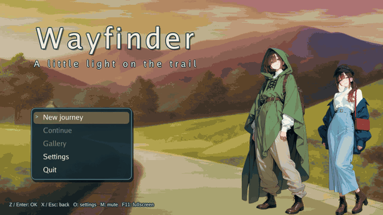

[](https://github.com/nao1215/gozen/actions/workflows/ci.yml)
[](https://github.com/nao1215/gozen/actions/workflows/security.yml)
[](https://github.com/nao1215/atago)
[](https://pkg.go.dev/github.com/nao1215/gozen)


# Gozen

Gozen は Go と Ebitengine による 2D RPG のフレームワークと制作ツールです。ゲームは YAML と自分の絵で作ります。同じ規則を、ウィンドウ、描画なしの Go ドライバー、定義の検証とシミュレーションを行うコマンドの 3 つで動かせるので、ディスプレイのない CI でもバランスと物語の進行を試せます。

[English](README.md)



上の動画は [examples/play](examples/play) のサンプル Wayfinder です。ゲームそのものを、描画ループから録画しています。

Gozen は開発中で、v0 の API を整備しています。公開版のリリースはまだありません。

## 30 秒で試す

Go 1.26.4 以降があれば、リポジトリを取得して一番小さいゲームを動かせます。ディスプレイも素材も要りません。

```sh
git clone https://github.com/nao1215/gozen
cd gozen
go run ./examples/minimal
```

```text
location=camp gold=2
```

ゲームは 2 つの YAML と 35 行の Go の起動コードです。`data.Load` が埋め込んだ `fs.FS` を読み、`rpg.New` が状態を作り、`headless.New(db, state).Start()` が最初の場所の到着イベントを実行します。

```yaml
# game.yaml
schema_version: 1
id: tiny-trail
title: Tiny trail
start: {location: camp, party: [walker]}
```

```yaml
# data/world.yaml
classes:
  walker:
    name: Walker
    stats: {mhp: 20, mmp: 0, atk: 4, def: 2, mat: 0, mdf: 0, agi: 4, luk: 1}
    exp_for: level * 20
actors: {walker: {name: Walker, class: walker}}
locations:
  camp:
    name: Camp
    on_enter: [{say: A new trail begins here.}, {gold: 2}]
skills:
  attack: {name: Tap, effects: [{damage: 4}]}
  guard: {name: Wait, scope: self}
```

戦闘のないゲームでも、既定の `attack` と `guard` のスキル ID は定義します。

## サンプルを遊ぶ

ディスプレイのある環境で実行します（Linux は X11 と OpenGL のライブラリが必要です。[OS 別の準備](docs/development/graphics.md#requirements)）。

```sh
go run ./examples/play --mute
```

New journey を選び、配達人と話し、練習戦闘に勝ち（Auto なら自動で戦います）、道標に灯をともして尾根へ向かいます。Save journey で保存し、タイトルの Continue で復元できます。村には宿屋があり、洞窟では野生の Pebble と何度でも戦えます。観測室は小さな地図つきの一人称グリッド移動です。[遊び方と操作](docs/examples/wayfinder.md)。

同じ実行から撮った画面です。

| Title | Conversation | Battle |
|:--|:--|:--|
|  |  |  |

## なぜ Gozen か

用途に合う道具を選んでください。

| やりたいこと | 使うもの |
|:--|:--|
| RPG の規則を持たない汎用の 2D ゲームライブラリ | [Ebitengine](https://ebitengine.org/)（Gozen の土台） |
| RPG のマップとイベントを画面で編集するエディタ | [RPG Maker](https://www.rpgmakerweb.com/) |
| シーンエディタと多くの出力先を持つゲームエンジン | [Godot](https://godotengine.org/) |
| Go のプログラムの中で、データとして定義した RPG を、描画なしのドライバーと検証・シミュレーション・撮影の CLI で扱う | Gozen |

Gozen が大事にしているのは、ゲームを試せるデータとして扱うことです。タイトル画面を描く定義を、`gozen check` が参照と式の検査に、`gozen sim` が勝率の計測に、`headless` が Go のテストに、そのまま読み込みます。壊れた参照やバランスの退行は、プレイヤーの前ではなく CI で失敗します。

## インストール

Gozen は Go のモジュール `github.com/nao1215/gozen` 1 つで、Go 1.26.4 以降が必要です。公開版からの導入は未確認です。リリースまでは、ソースのチェックアウトから `gozen` コマンドを導入します。

```sh
mkdir -p bin
GOBIN="$PWD/bin" go install -trimpath -buildvcs=false ./cmd/gozen
```

PowerShell では先に `$env:GOBIN = Join-Path $PWD bin` を設定します。リリース後は `go install github.com/nao1215/gozen/cmd/gozen@latest` の形になります。C コンパイラが無いと Go は cgo なしで組み立て、その `gozen mosaic` は ONNX 推論が無いことを知らせます。ライブラリとして使うときは `go get github.com/nao1215/gozen@latest` でモジュールを追加します。

## 動作環境

サンプルとツールのビルドには Go 1.26.4 以降が必要です。画面付きゲームはディスプレイと OS の描画ライブラリを使います。`--mute` で音声デバイスの初期化を省けます。Linux の X11・OpenGL は pure Go ビルドでも実行時に必要です。Ubuntu のパッケージと Windows/macOS の準備は [画面の導入手順](docs/development/graphics.md#requirements) にあります。

| 対象 | 追加の前提 |
| --- | --- |
| 中核・描画なしの例・gozen の通常のサブコマンド | なし。画面・C コンパイラ不要 |
| 画面付きゲーム・gozen shots | 描画環境。Linux の無人実行は Xvfb と xauth |
| gozen prompt | 利用者の catalog YAML。モデル・画像生成サービス不要 |
| gozen mosaic の推論 | ビルド時に cgo と C コンパイラ。実行時に対応する ONNX Runtime と利用者のモデル |
| サンプル動画の撮影 | Linux の描画環境、Xvfb、xauth、Bash、Python 3、ffmpeg/ffprobe |

## レシピ

リポジトリのルートから実行します。

### Go から描画なしで動かす

`headless` はウィンドウなしで規則を動かします。[examples/headless](examples/headless/main.go) は乱数の固定、移動、選択、戦闘、保存、復元をメモリ上で行います。

```sh
go run ./examples/headless
```

```text
location=trail battles=1 wins=1 gold=3
```

### 埋め込んだゲームをウィンドウで動かす

[examples/play/main.go](examples/play/main.go) はゲームのディレクトリを埋め込み、runner に渡します。

```go
//go:embed game
var files embed.FS

fsys, err := fs.Sub(files, "game") // game.yaml, data/, assets/
if err != nil {
	log.Fatal(err)
}
err = runner.Run(ctx, fsys, ".", runner.Config{Args: os.Args[1:], Output: os.Stdout})
```

`runner` は `--mute`・`--seed`・`--window`・`--save-dir` を受け付けます。`--start`・`--script` などの制作機能は `--dev` が必要です。セーブは OS の config ディレクトリの `gozen/<game-id>` 配下に置きます。スクリプト実行は保存先を明示しなければ一時保存を使います。FS・出力 Writer・プロセスの終了はゲーム側が所有します。

Ebitengine の既存ループへ画面を組み込むときは `play.New` を使い、`Game.Update`・`Draw`・`Layout`・`Close` を呼びます。[表示 API の契約](docs/architecture/presentation-api.md)を参照してください。描画はメインスレッドで行い、同時に動かせるゲームはプロセス内に 1 つです。

### 上の動画を撮り直す

`scripts/capture-example.sh` は Wayfinder をビルドし、キー入力のスクリプトで遊ばせ、描画ループからフレームを取り、保存データに完走した記録があることを確かめて、GIF にします。見えない画面（仮想ディスプレイ）の中で動くので、手元の画面にウィンドウは出ません。

```sh
xvfb-run --auto-servernum bash scripts/capture-example.sh
```

Xvfb・xauth・Python 3・ffmpeg・ffprobe が必要です。[撮影の詳細](docs/examples/wayfinder.md#capture)。

## CLI 一覧と例

以下はリポジトリのルートから実行します。検証・シミュレーションには、画面サンプルとは別の小さな中立の fixture を使います。[gozen の全サブコマンド](docs/development/cli.md#コマンド)。

### gozen

Requirements: ビルドに Go。通常の検査・シミュレーション・レポートと `prompt` は画面・C コンパイラ不要です。`shots` はゲームのバイナリと描画環境を使います。`mosaic` の推論には cgo で組み立てた gozen、対応する ONNX Runtime、利用者のモデルが必要です。[OS 別要件](docs/development/cli.md#requirements)。各サブコマンドの flag と前提は `gozen help <command>` で見られます。

`gozen check` は定義・参照・式・素材の存在と文字の収まりを検査します。`--no-layout` はフォントを使う収まりの検査を省きます。

```sh
go run ./cmd/gozen check --no-layout e2e/atago/fixtures/game
```

```text
ok: 2 locations, 1 events, 1 actors, 2 skills, 0 items, 1 enemies, 1 troops, 0 ai sets
Structure checked; layout was not checked. Use gozen layout <game-dir>.
```

`gozen sim` は乱数を固定して敵の編成と何度も戦い、勝率とターン数を報告します。

```sh
go run ./cmd/gozen sim e2e/atago/fixtures/game lesson -n 3 --seed 7
```

```text
lesson: 3 battles  win 100%  lose 0%  fled 0%  draw 0%  avg turns 1.0  avg standing after a win 1.0
```

`go run ./cmd/gozen --help` で他のサブコマンド（`layout`・`curve`・`floors`・`trace`・`book`・`design`・`memos`・`release`・`trial`・`shots`・`prompt`・`mosaic`・`version`・`help`）を見られます。

`gozen prompt` は catalog YAML を使い、cgo・モデル・外部サービスは不要です。画像生成用の文面を組み立てます。画像の生成やジョブの送信は行いません。

```sh
go run ./cmd/gozen prompt --config docs/examples/production/catalog.yaml --scene landscape --format json
```

複数の構図は `--scenes ids.txt --format json`（1行1 ID）で一括出力できます。[出力と終了値](docs/development/production-tools.md#gozen-prompt)を参照してください。

`gozen mosaic` の推論には、ビルド時の C コンパイラ、対応する ONNX Runtime、利用者のモデルも必要です。手修正だけの処理では推論用の実行環境は不要です。[準備とモデルの契約](docs/development/production-tools.md)。

```sh
go run ./cmd/gozen mosaic --help
mkdir -p build/mosaic-input/assets
cp docs/examples/production/pattern.png build/mosaic-input/assets/pattern.png
go run ./cmd/gozen mosaic auto --fix docs/examples/production/fixes.yaml --out build/mosaic-output build/mosaic-input pattern.png
```

新規に作った合成画像の矩形を、推論なしでピクセル化します。入力は変えず、出力画像と report は `build/mosaic-output` に置きます。

## 機能

- 参照検証・式・条件付きイベントを備えた YAML 定義。
- 自動戦闘つきのターン制戦闘、場所の移動、一人称のグリッド探索、版付きのセーブ。
- 画面付きと同じ規則を使う、描画なしのシミュレーション。
- Ebitengine の画面、フォント描画、音声、埋め込みゲームの起動口。
- 会話の立ち絵、タイトルの立ち絵、場所と戦闘の背景、フィールドメニュー。
- 検証・シミュレーション・制作・画像処理をサブコマンドで行う `gozen` コマンド。

## 設定

`game.yaml` にゲーム ID・スキーマ版・開始場所と仲間・画面・フォント・UI の翻訳を置きます。`data/` 以下の YAML（サブディレクトリも対象）に定義とイベントを書きます。素材のパスは、渡す `fs.FS` の `assets/` からの相対パスです。[スキーマ一覧](docs/schema.md)。

## 対応 OS

CI の対象は Linux・Windows・macOS です。amd64 のビルドと Linux/macOS arm64 のクロスビルドを設定しています。Linux amd64 では、テスト・ビルド・CLI のシナリオ・5 画面の実描画・撮影パイプラインを確認しました。Windows/macOS の実行、実音声、ONNX 実推論、リモート CI の成功は未確認で、クロスビルドだけでは実行の確認に数えません。[公開前の点検手順](docs/development/release-checklist.md)。

## 操作方法

メニューは上下キーで選択、Enter/Z で決定、X/Esc で戻る・メニュー表示です。観測室は上で前進、左右で方向転換、下で振り向きます。M でミュート、F11 で全画面を切り替えます。

## テスト

```sh
make test lint build
# Linux の仮想ディスプレイ内で:
xvfb-run --auto-servernum make graphics
```

lint は go-arch-lint v1.19.0・golangci-lint v2.14.0・actionlint v1.7.12 を使います。Make は必須ではありません。直接の実行手順と CLI の E2E は [テスト](docs/development/testing.md) にあります。

## 制限

- 公開版のインストールは未確認で、Windows/macOS の実行確認はこれからです。
- サンプルの一部の補助画面には既定の日本語が残り、Go Regular には一部の記号の字形がありません。サンプルに音楽はありません。
- `x/` は予約ディレクトリのみで、利用できる Go パッケージはなく、互換性も約束しません。
- ONNX のモデルと共有ライブラリは同梱しません。

[v0 の範囲](docs/decisions/0002-public-api-scope.md)を参照してください。

## ドキュメント

[全体設計](docs/architecture/overview.md) · [API 規約](docs/architecture/api-guidelines.md) · [中核 API](docs/architecture/core-api.md) · [表示 API](docs/architecture/presentation-api.md) · [ADR](docs/decisions/index.md) · [CI](docs/development/ci.md) · [CLI](docs/development/cli.md) · [制作支援](docs/development/production-tools.md) · [公開前の点検手順](docs/development/release-checklist.md)

## 貢献

[CONTRIBUTING.md](CONTRIBUTING.md) を参照してください。脆弱性の報告は [SECURITY.md](SECURITY.md) の手順に従います。変更は [変更履歴](CHANGELOG.md) にあります。

## ライセンス

コードは [MIT](LICENSE)、サンプル Wayfinder の絵は CC BY 4.0 です（[examples/play/game/assets/LICENSE](examples/play/game/assets/LICENSE)）。Go Regular フォントの通知は [ASSETS.md](ASSETS.md) にあります。
