<!-- ALL-CONTRIBUTORS-BADGE:START - Do not remove or modify this section -->
[](#contributors-)
<!-- ALL-CONTRIBUTORS-BADGE:END -->

[](https://github.com/nao1215/gozen/actions/workflows/ci.yml)
[](https://github.com/nao1215/gozen/actions/workflows/reviewdog.yml)
[](https://github.com/nao1215/gozen/actions/workflows/security.yml)
[](https://github.com/nao1215/atago)
[](https://github.com/nao1215/himorime)
[](https://pkg.go.dev/github.com/nao1215/gozen)

[](https://github.com/nao1215/gozen/releases)
[](https://scorecard.dev/viewer/?uri=github.com/nao1215/gozen)


<p align="center">
  <picture>
    <source media="(prefers-color-scheme: dark)" srcset="docs/images/gozen-logo-dark.svg">
    
  </picture>
</p>

# Gozen

Gozen is a framework for 2D RPGs and visual novels in Go and Ebitengine. You write the game in YAML: places, battles and skills for an RPG; lines, choices and staging for a novel, with roll back, skip and a second language. `gozen check` finds broken references. `gozen sim battle` measures balance. While you play, F5 reloads the YAML, F9 saves a note, and F7 and F8 show win rates and flags.

Documentation: https://nao1215.github.io/gozen/

| RPG: [Go Zen](examples/go-zen) | Novel: [After the Pass](examples/novel) |
|:--|:--|
| 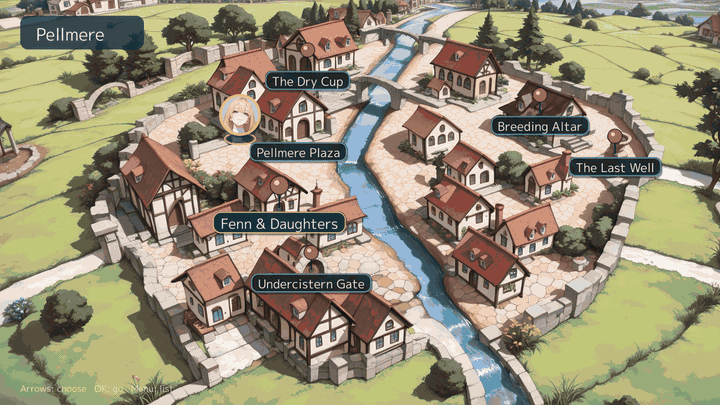 | 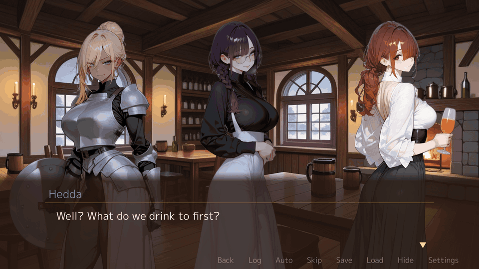 |

## Try it

Go 1.26.10 or later. No display or assets needed:

```sh
go run github.com/nao1215/gozen/examples/minimal@latest
```

<!-- verify: output -->
```text
location=camp gold=2
```

That game is two YAML files and a 43-line Go host. The sample above is [Go Zen](examples/go-zen), a module of its own. Play it from a clone:

<!-- verify: skip needs a clone of the repository and opens the game window -->
```sh
git clone https://github.com/nao1215/gozen
cd gozen/examples/go-zen
go run . --mute
```

Play Go Zen and After the Pass in the browser: https://nao1215.github.io/gozen/play/

## The loop

| Step | Tool |
|:--|:--|
| Write | YAML: places, battles, skills, enemy tactics, events, dialogue. |
| Check | `gozen check` prints file and line: `data/world.yaml:26:5: locations.grotto.encounters: unknown troop "lessn" [GZN1101]`. |
| Measure | `gozen sim battle` prints a win rate. `gozen sim dive` plays a dungeon dive. F7 shows the same numbers in the game. |
| Play | `--dev` starts anywhere, autoplays, records and replays a trace. |
| Note | F9 saves the moment. `--from-memo` starts at that line. |
| Fix | Edit the YAML under `--dir` and press F5. The game keeps your place. |

The window, a headless session and the command line share the rules. The keys are in [Playtesting](#playtesting).

## Screens

All from [Go Zen](examples/go-zen) at 1920x1080.

| Conversation | Painted scene |
|:--|:--|
| 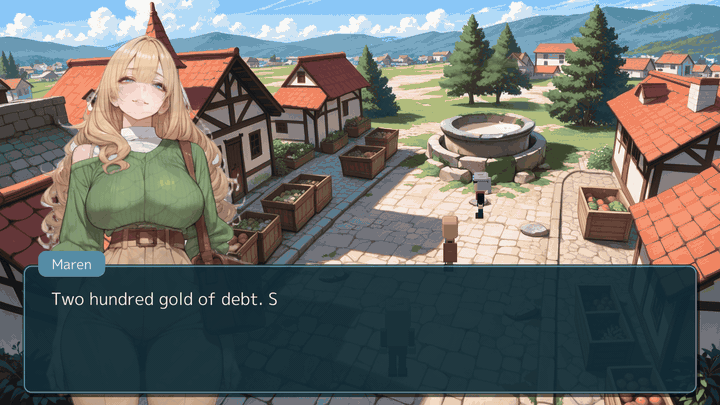 | 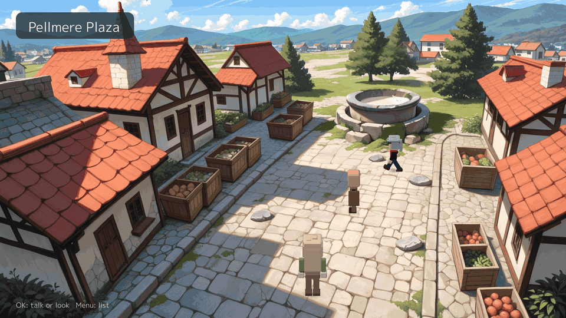 |
| Town map | First-person dungeon |
| 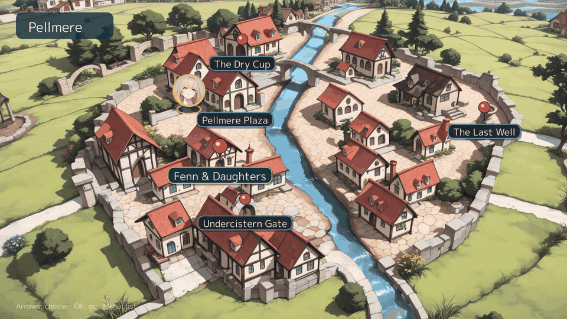 | 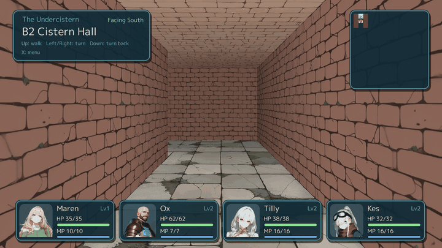 |
| Battle | Cut-in |
| 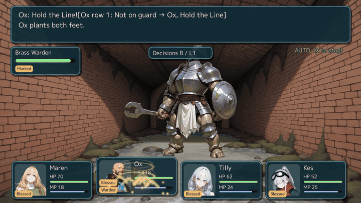 | 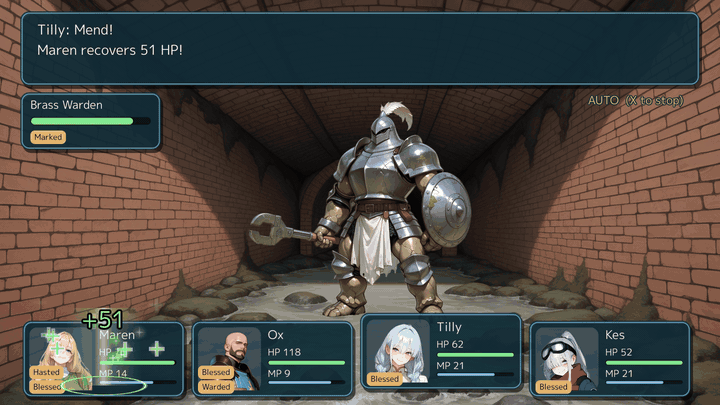 |
| Shop | Skill tree |
| 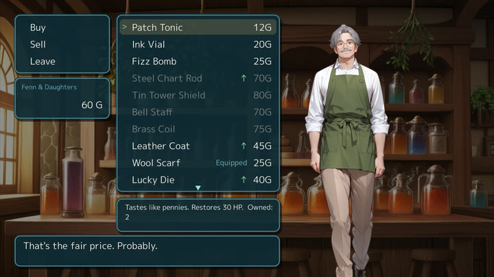 | 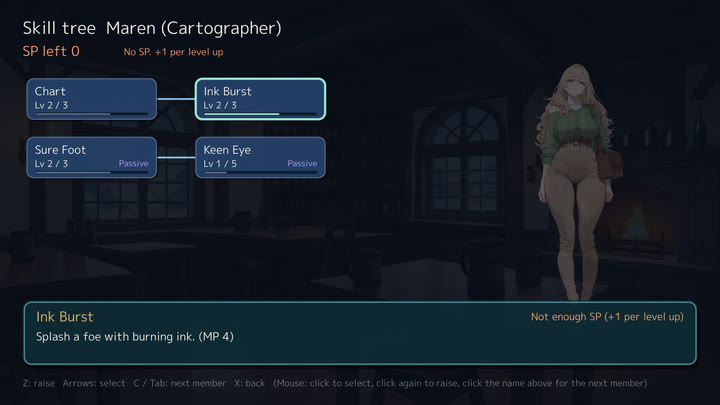 |
| Title | |
| 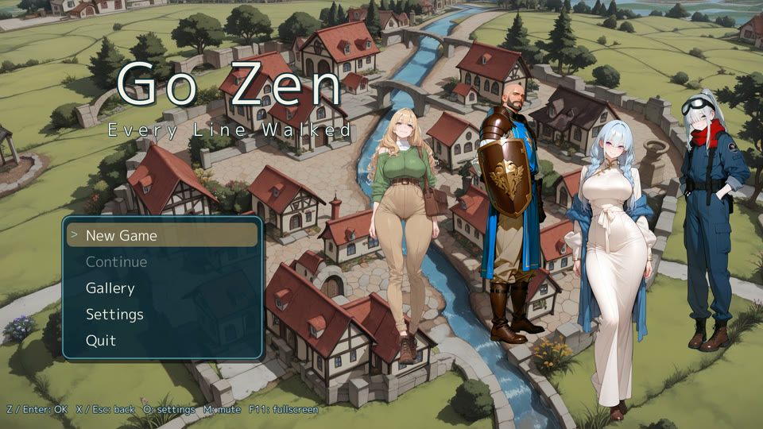 | |

### Novel games

`ui.message: novel` makes a visual novel. All from [After the Pass](examples/novel), the novel sample, at 1920x1080.

| Roll back (Q, wheel) | Skip to the line not read (N) |
|:--|:--|
| 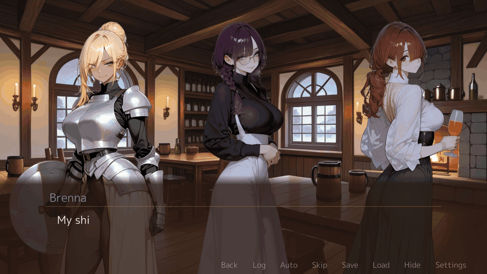 | 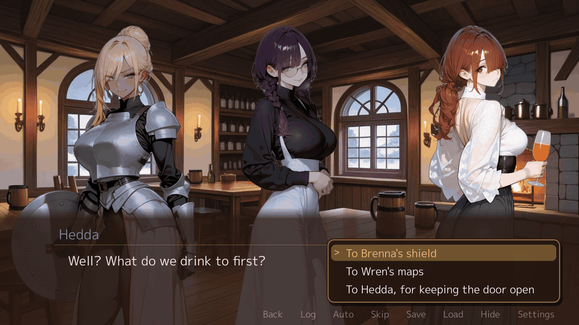 |
| Two languages | Staging (`stand`, `effect`) |
|  | 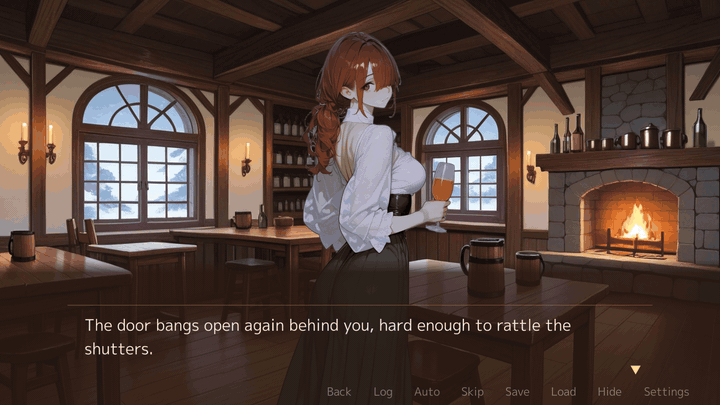 |
| Event picture with its line | |
| 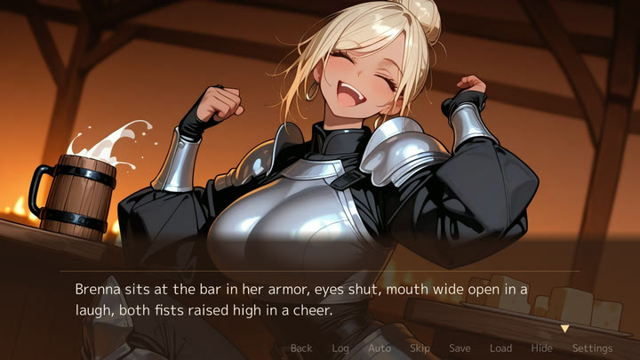 | |

## Playtesting

Start the game with `--dev` and these keys work while you play.

| F5: edit the YAML under `--dir`, the line changes in place | F9: a note with the screen and the state |
|:--|:--|
| 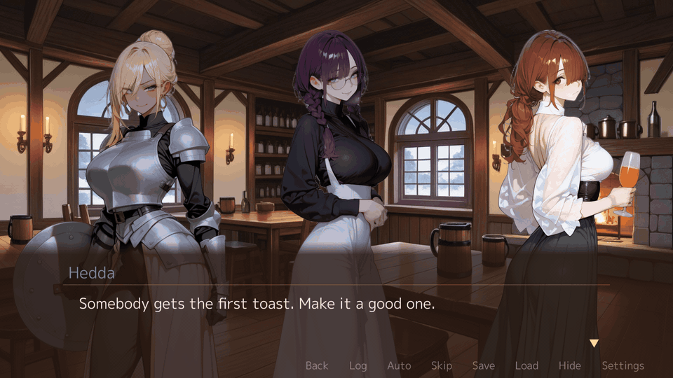 |  |
| F7: win rates of the battles here | F8 State: flip a flag, step a number |
| 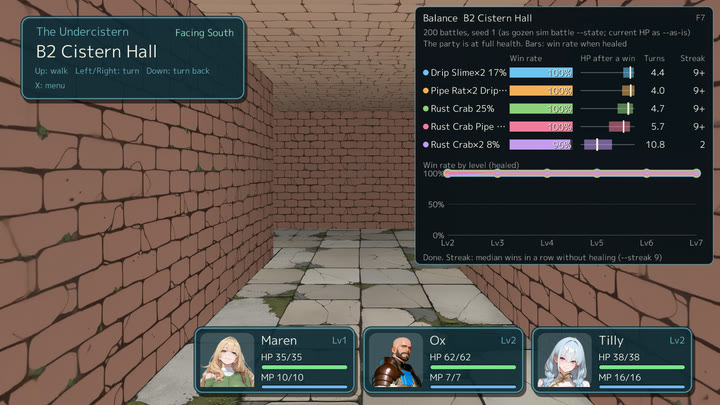 | 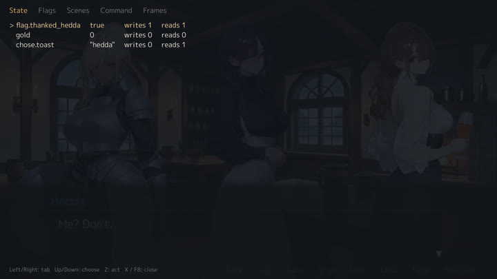 |
| F8 Flags: what each event sets and reads | F8 Scenes: jump to an event |
| 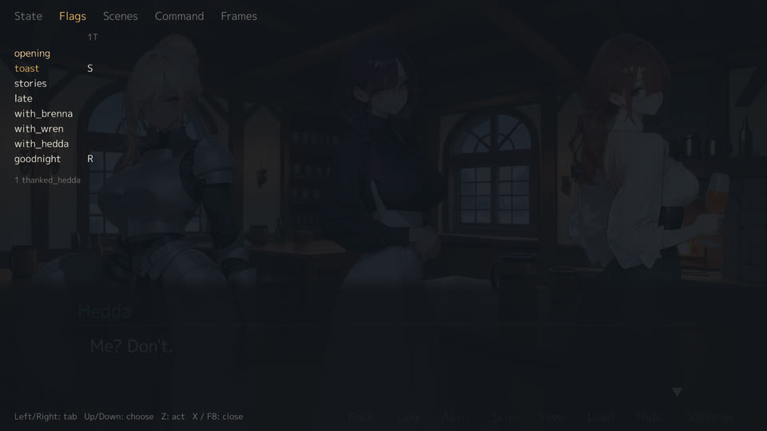 | 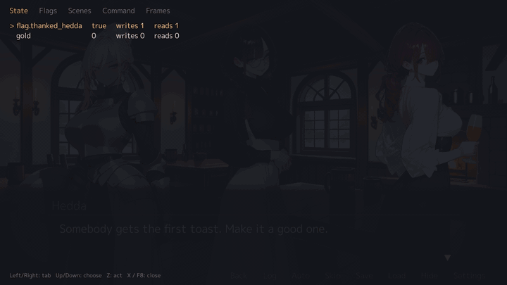 |
| F8 Command: run a line of YAML | F8 Frames: ticks and frames a second, the slowest Update and Draw |
| 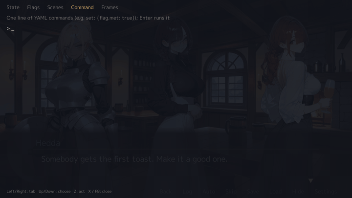 | 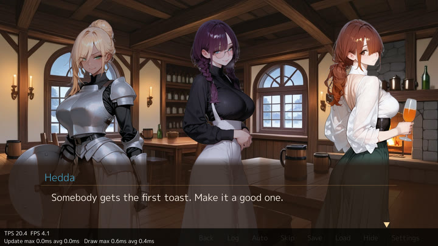 |
| F6: the character book, every page open: each character's profile, faces and relations | |
| 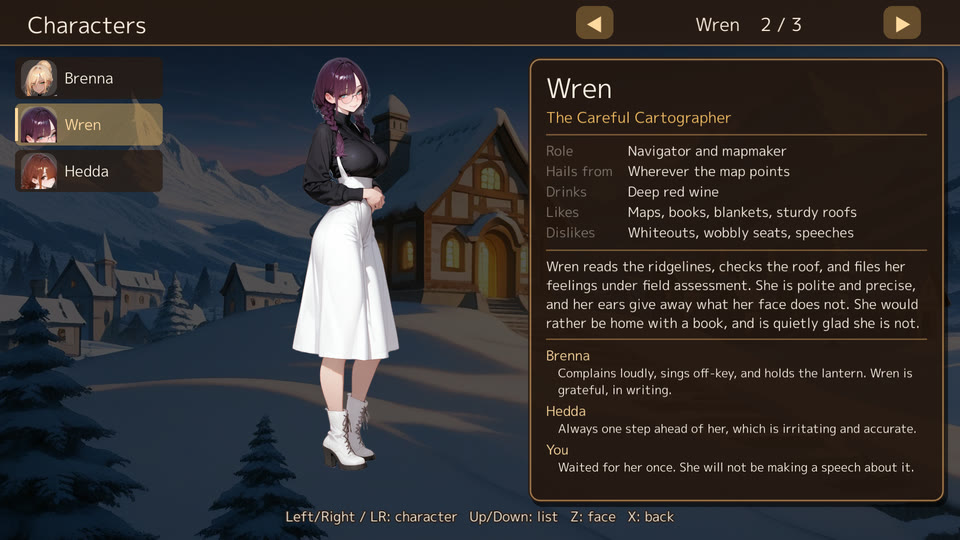 | |

## Install

Go 1.26.10 or later:

```sh
go install github.com/nao1215/gozen/cmd/gozen@latest
```

With a C compiler, `CGO_ENABLED=1` adds the ONNX inference of `gozen art mosaic`.

With Homebrew:

<!-- verify: skip installs from the Homebrew tap, outside the repository -->
```sh
brew install --cask nao1215/tap/gozen
```

[The release page](https://github.com/nao1215/gozen/releases) has archives for Linux, macOS and Windows (amd64, arm64) and `.deb`, `.rpm` and `.apk` packages. They have no ONNX inference.

As a library:

<!-- verify: run fixture=module -->
```sh
go get github.com/nao1215/gozen@latest
```

The window needs the platform graphics libraries: [OS setup](https://nao1215.github.io/gozen/install/#what-the-window-needs).

In GitHub Actions, [setup-gozen](https://github.com/nao1215/setup-gozen) installs the release binary of the version in your `go.mod`, checked against the release checksums:

<!-- verify: skip runs in GitHub Actions -->
```yaml
- uses: actions/checkout@v6
- uses: nao1215/setup-gozen@b8c63e495b0aa9013d2308664a904f03009785a9 # v0.1.0
- run: gozen check game
- run: gozen sim battle game boss --format json  # boss: a troop id of your game
```

`version` also takes `latest` or a release such as `v0.2.0`, and `go-mod-path` points at a `go.mod` below the root. Without the action, `go run github.com/nao1215/gozen/cmd/gozen check game` builds the same version from `go.mod`.

## Recipes

Tested YAML recipes are in the [cookbook](https://nao1215.github.io/gozen/cookbook/).

With a coding agent, install the [gozen skill](skills/gozen/SKILL.md). It holds the schema links and one rule: run `gozen check` until it passes.

- Claude Code: copy `skills/gozen` to `~/.claude/skills/gozen`.
- Codex: copy `skills/gozen` to `~/.codex/skills/gozen`.

<!-- verify: run fixture=cave -->
```sh
gozen check game                                       # references, expressions, pictures, text layout
gozen sim battle game cave_boss --level 8              # win rate at level 8
gozen sim dive game cave --floors 5 --boss 5:cave_boss # levels and wins per floor
```

`gozen book game > book.md` writes the whole game as one Markdown file.

Test tools of your game's binary:

<!-- verify: skip runs in your own game's module and opens the game window -->
```sh
go run . --dev --dir game --memos notes                   # F9 note, F7 win rates, F5 reload
go run . --dev --start cave --level 8 --battle cave_boss  # jump to a fight
go run . --dev --autoplay 60 --speed 8 --trace run.jsonl  # autoplay and record
gozen play trace run.jsonl                                # read the record
gozen play notes notes                                    # notes as one HTML page
```

Embed a game:

```go
//go:embed game
var files embed.FS

func main() {
	// game/ holds game.yaml, data/ and assets/; the options are the game's (--help, --dev ...)
	if err := play.Main(context.Background(), files, "game", os.Args[1:], play.Config{Output: os.Stdout}); err != nil {
		log.Fatal(err)
	}
}
```

Test it in Go with `gozen.Session`, which runs the rules without a window:

```sh
go run github.com/nao1215/gozen/examples/headless@latest
```

<!-- verify: output -->
```text
location=trail battles=1 wins=1 gold=3
```

## gozen

| Command | What it does |
|:--|:--|
| `check` | definitions, references, expressions, pictures, text layout (`--only structure` or `--only layout`) |
| `sim battle`, `sim dive`, `sim floors`, `sim design` | win rate; a dungeon dive; generated floors; scripted players |
| `play trace`, `play notes`, `play shots` | read a trace; notes as HTML; screenshots of a list |
| `book` | the whole game as Markdown |
| `pack release`, `pack trial` | approved pictures only; a demo |
| `art prompt`, `art mosaic`, `art fetch`, `art faces`, `art puppet` | image prompts; pixelation; models; balloon faces; moving portraits |
| `theme add`, `theme list` | copy a dungeon theme (walls, floor, ceiling, door) into a game; list the themes |
| `version`, `help` | the version; a command's help, or a diagnostic code |

`gozen help <command>` shows options and examples. `gozen help GZN1101` explains a code. [atago](https://github.com/nao1215/atago) tests every command end to end.

## Features

- YAML definitions with expressions, events and versioned saves
- Turn-based battles with a party, auto battle and enemy tactics
- Skill trees, shops, a field menu and a picture gallery
- First-person grid dungeons, fixed or generated
- Moving portraits from one picture ([puppet](https://pkg.go.dev/github.com/nao1215/gozen/puppet))
- Characters that react to typed words, and a chat log ([react](https://pkg.go.dev/github.com/nao1215/gozen/react), [chat](https://pkg.go.dev/github.com/nao1215/gozen/chat))
- Visual novels: roll back, skip what was read, save in a scene, choices read as `chose`, staging with `stand` ([recipes](https://nao1215.github.io/gozen/cookbook/#let-the-player-roll-back-and-save-in-a-scene))
- Engine words in English and Japanese (`language` in game.yaml), and the game's text in two languages (`lang/`)

## Limitations

- The API may change before v1.
- Runtime checks run on Linux. Windows and macOS are built in CI, not played.
- There is no graphical editor.

## Contributing

See [CONTRIBUTING.md](CONTRIBUTING.md), the [Code of Conduct](CODE_OF_CONDUCT.md), [SUPPORT.md](.github/SUPPORT.md) and [SECURITY.md](SECURITY.md).

## Support

A star or a [GitHub Sponsors](https://github.com/sponsors/nao1215) sponsorship helps.

## License

The code is [MIT](LICENSE). The Go Zen and After the Pass pictures and music are CC BY 4.0 ([Go Zen](examples/go-zen/game/assets/LICENSE), [After the Pass](examples/novel/game/assets/LICENSE)). Font notices are in [ASSETS.md](ASSETS.md).

## The name

Ebitengine is named after ebiten (海老天), shrimp tempura. In Japan, an ebiten gozen (御膳) is a set meal on one tray: shrimp tempura with soba, small side dishes, and a sweet such as dango. Gozen is that tray for Ebitengine: the engine served with everything an RPG needs. The name also starts with Go.

## Contributors ✨

Thanks goes to these wonderful people ([emoji key](https://allcontributors.org/en/reference/emoji-key/)):

<!-- ALL-CONTRIBUTORS-LIST:START - Do not remove or modify this section -->
<!-- prettier-ignore-start -->
<!-- markdownlint-disable -->
<table>
  <tbody>
    <tr>
      <td align="center" valign="top" width="14.28%"><a href="https://debimate.jp/"><br /><sub><b>CHIKAMATSU Naohiro</b></sub></a><br /><a href="https://github.com/nao1215/gozen/commits?author=nao1215" title="Code">💻</a> <a href="https://github.com/nao1215/gozen/commits?author=nao1215" title="Documentation">📖</a></td>
    </tr>
  </tbody>
</table>

<!-- markdownlint-restore -->
<!-- prettier-ignore-end -->

<!-- ALL-CONTRIBUTORS-LIST:END -->

This project follows the [all-contributors](https://github.com/all-contributors/all-contributors) specification. Contributions of any kind are welcome.
