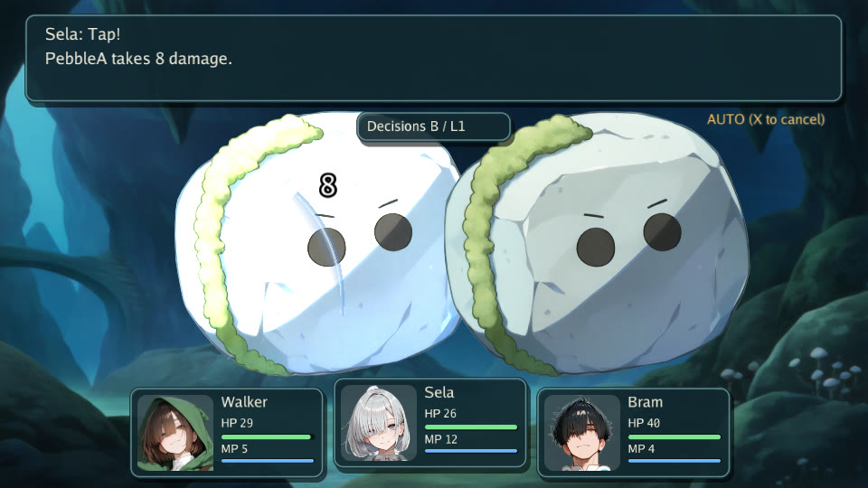
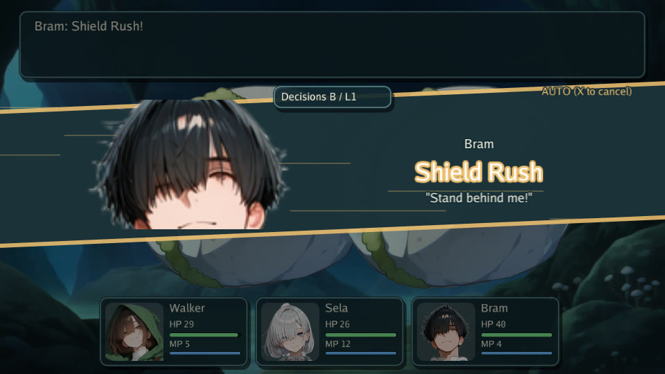
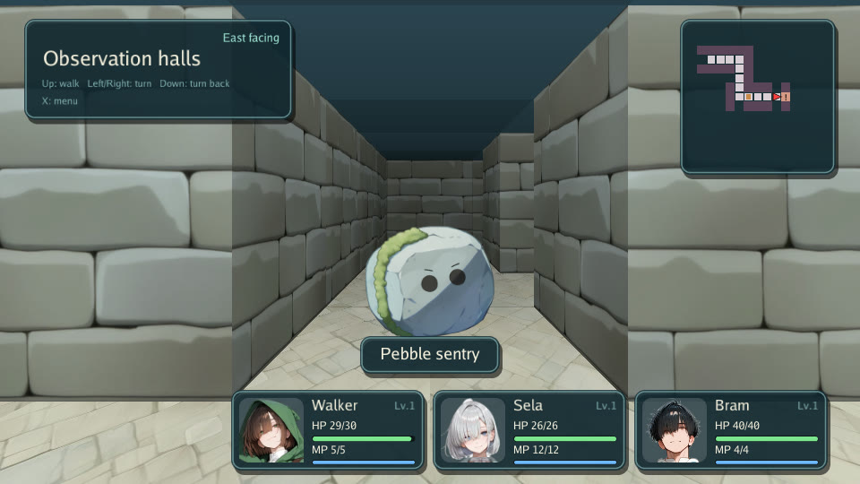

[](https://github.com/nao1215/gozen/actions/workflows/ci.yml)
[](https://github.com/nao1215/gozen/actions/workflows/security.yml)
[](https://github.com/nao1215/atago)
[](https://pkg.go.dev/github.com/nao1215/gozen)


# Gozen

Gozen is a 2D RPG framework for Go and Ebitengine built for a fast edit–play loop. You (or your coding agent) write the game as YAML. `gozen check` and `gozen sim` catch broken references and bad balance before anyone plays. While you play, you leave notes on the exact moment, watch live win rates, and reload the YAML without restarting.

Documentation: **https://nao1215.github.io/gozen/**


## Try it in 30 seconds

If you have Go 1.26.4 or later, paste this. It needs no display and no assets:

```sh
go run github.com/nao1215/gozen/examples/minimal@latest
```

```text
location=camp gold=2
```

That game is two YAML files and a 35-line Go host. To play the sample above in a window:

```sh
go run github.com/nao1215/gozen/examples/play@latest --mute
```

## Why Gozen?

Making an RPG is mostly tuning: a line that reads wrong, a boss that is too hard, a dungeon that is too long. Gozen shortens each round of that loop.

| Step | What Gozen gives you |
|:--|:--|
| Write | The whole game is plain YAML: places, battles, skills, the enemies' tactics, events and dialogue. Text is easy for you and for a coding agent to write, diff and review. |
| Check | `gozen check` reports broken references, wrong expressions, missing pictures and text that overflows its window, with file and line: `data/world.yaml:26:5: locations.grotto.encounters: unknown troop "lessn"`. |
| Measure | `gozen sim` fights a battle hundreds of times and prints the win rate. `gozen curve` plays a whole dungeon dive. The same numbers appear in the game with F7. |
| Play | `--dev` adds test tools: start anywhere, autoplay at high speed, record and replay a trace. |
| Note | F9 saves a note with a screenshot and the game state. `--from-memo` starts the game again at that exact line. |
| Fix | Run the game with `--dir`, edit the YAML and press F5. The game reloads its definitions and keeps your place. |

The rules are shared by the window, a headless driver and the command line, so a test in CI and a player see the same game.

## Screens

| A party of three | Cut-in on a special skill |
|:--|:--|
|  |  |
| **First-person dungeon** | **Balance panel (F7)** |
|  |  |
| **Conversation** | **Village** |
|  |  |

## Install

```sh
go install github.com/nao1215/gozen/cmd/gozen@latest
```

As a library:

```sh
go get github.com/nao1215/gozen@latest
```

The graphical game needs the platform graphics libraries (on Linux, X11 and OpenGL). See [OS setup](https://nao1215.github.io/gozen/docs/setup/).

## Recipes

### Let a coding agent write the game

Point your agent at the [schema](https://nao1215.github.io/gozen/docs/schema/) and give it one rule: run `gozen check` until it passes. A typical round:

```sh
gozen check game                                  # references, expressions, pictures, text layout
gozen sim game cave_boss --level 8                # win rate of the party at level 8
gozen curve game cave --floors 5 --boss 5:cave_boss  # a whole dive: levels and wins per floor
```

`gozen book game > book.md` writes every place, enemy, skill and line of dialogue as one Markdown file, which is a quick way to review what the agent wrote.

### Play with the test tools

```sh
go run . --dev --dir game --memos notes             # F9 leaves a note, F7 shows win rates, F5 reloads
go run . --dev --start cave --level 8 --battle cave_boss  # jump straight to a fight
go run . --dev --autoplay 60 --speed 8 --trace run.jsonl  # play by itself, fast, and record
gozen trace run.jsonl                                # read what happened
gozen memos notes                                    # all notes as one HTML page
```

### Embed a game in your program

```go
//go:embed game
var files embed.FS

func main() {
	fsys, err := fs.Sub(files, "game") // game.yaml, data/, assets/
	if err != nil {
		log.Fatal(err)
	}
	if err := runner.Run(context.Background(), fsys, ".", runner.Config{Args: os.Args[1:], Output: os.Stdout}); err != nil {
		log.Fatal(err)
	}
}
```

### Test the game in Go

`headless` runs the same rules without a window: move, choose, fight, save and load in a normal Go test.

```sh
go run github.com/nao1215/gozen/examples/headless@latest
```

```text
location=trail battles=1 wins=1 gold=3
```

## gozen

| Command | What it does |
|:--|:--|
| `check` | validate definitions, references, expressions, pictures and text layout |
| `sim` | fight a battle many times and report the win rate |
| `curve`, `floors` | simulate a dungeon dive and the size of its floors |
| `trace` | read a play trace as a short timeline |
| `book`, `design` | write the whole game as Markdown; let scripted players finish it |
| `memos` | collect test players' notes into one HTML page |
| `trial`, `release` | cut a demo version; package approved pictures |
| `shots` | take screenshots of listed scenes |
| `prompt`, `mosaic` | build image-generation prompts; pixelate parts of pictures |

`gozen help <command>` shows the options and examples of each command. Every command is tested end to end with [atago](https://github.com/nao1215/atago).

## Features

- YAML definitions with expressions, conditional events and versioned saves
- Turn-based battles with a party, auto battle and per-enemy tactics (gambits)
- Skill trees, shops, a field menu and a picture gallery
- First-person grid dungeons, fixed or generated floors
- Characters that react to typed words and events, and a chat log ([react](https://pkg.go.dev/github.com/nao1215/gozen/react), [chat](https://pkg.go.dev/github.com/nao1215/gozen/chat))
- A headless driver that shares the rules with the window

## Limitations

- Gozen is young. The API may change before v1.
- Runtime checks are done on Linux. Windows and macOS are built in CI but not yet played.
- There is no graphical map or event editor; the game is text.

## Contributing

Contributions are welcome. See [CONTRIBUTING.md](CONTRIBUTING.md). Report vulnerabilities as described in [SECURITY.md](SECURITY.md).

## Support

If Gozen helps you, a star or a [GitHub Sponsors](https://github.com/sponsors/nao1215) sponsorship keeps it going.

## License

The code is [MIT](LICENSE). The pictures of the Wayfinder sample are [CC BY 4.0](examples/play/game/assets/LICENSE). The Go Regular font notice is in [ASSETS.md](ASSETS.md).
