<!-- ALL-CONTRIBUTORS-BADGE:START - Do not remove or modify this section -->
[](#contributors-)
<!-- ALL-CONTRIBUTORS-BADGE:END -->

[](https://github.com/nao1215/gozen/actions/workflows/ci.yml)
[](https://github.com/nao1215/gozen/actions/workflows/reviewdog.yml)
[](https://github.com/nao1215/gozen/actions/workflows/security.yml)
[](https://github.com/nao1215/atago)
[](https://github.com/nao1215/himorime)

[](https://github.com/nao1215/gozen/releases)
[](https://scorecard.dev/viewer/?uri=github.com/nao1215/gozen)


<p align="center">
  <picture>
    <source media="(prefers-color-scheme: dark)" srcset="docs/images/gozen-logo-dark.svg">
    
  </picture>
</p>

# Gozen

Gozen is a no-code toolkit for creating 2D RPGs, visual novels and strategy games with YAML and assets. Create a template, edit its text and rules, and play it with one command. No Go code or compiler is required to create and play a game. Built with Go and Ebitengine.

Documentation: https://nao1215.github.io/gozen/

| RPG: [Go Zen](https://nao1215.github.io/gozen/play/go-zen/) (play in browser) | Novel: [After the Pass](https://nao1215.github.io/gozen/play/novel/) (play in browser) |
|:--|:--|
|  |  |
| Campaign: [Five Banners](https://nao1215.github.io/gozen/play/campaign/) (play in browser) | Monster collection: [Go Zen](https://nao1215.github.io/gozen/play/go-zen/) (play in browser) |
| 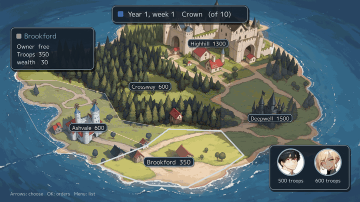 | 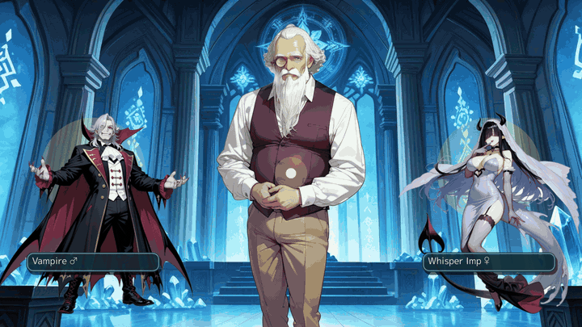 |

## Try it

Install the `gozen` binary from [Releases](https://github.com/nao1215/gozen/releases) or follow the [installation guide](https://nao1215.github.io/gozen/install/).

```sh
gozen new my-game --template rpg
gozen check my-game
```

<!-- verify: skip opens a window; generated templates are played by the graphics E2E -->
```sh
gozen run my-game
```

Choose `novel` or `campaign` for another template. Edit `game.yaml` and `data/world.yaml` in a text editor; no programming language is needed. YAML editing and terminal commands are the current interface, not a visual editor.

Play the larger samples in your browser: https://nao1215.github.io/gozen/play/

## The loop

| Step | Tool |
|:--|:--|
| Write | YAML: places, battles, skills, enemy tactics, events, dialogue. |
| Check | `gozen check` prints file and line: `data/world.yaml:26:5: locations.grotto.encounters: unknown troop "lessn" [GZN1101]`. |
| Measure | `gozen sim battle` prints a win rate. `gozen sim dive` plays a dungeon dive. F7 shows the same numbers in the game. |
| Play | `--dev` starts anywhere, autoplays, records and replays a trace. |
| Note | F9 saves the moment. `--from-memo` starts at that line. |
| Fix | Edit the YAML under `--dir` and press F5. The game keeps your place. |

The window, a headless session and the command line share the rules. The keys are in [Playtesting](#playtesting).

## Screens

All from [Go Zen](examples/go-zen) at 1920x1080.

| Conversation | Painted scene |
|:--|:--|
|  |  |
| Town map | First-person dungeon |
|  |  |
| Battle | Cut-in |
|  |  |
| Shop | Skill tree |
|  |  |
| Title | |
|  | |

### Novel games

`ui.message: novel` makes a visual novel. All from [After the Pass](examples/novel), the novel sample, at 1920x1080.

| Roll back (Q, wheel) | Skip to the line not read (N) |
|:--|:--|
|  |  |
| Two languages | Staging (`stand`, `effect`) |
|  |  |
| Event picture with its line | |
|  | |

### Campaigns

`regions`, `factions` and `campaign` (schema version 5) make a war of regions over turns. A campaign can share a game with dungeons and towns: generals are the same actors, and `move` goes between them. From [Five Banners](examples/campaign), the campaign sample.

| The war map | A clash of armies |
|:--|:--|
| 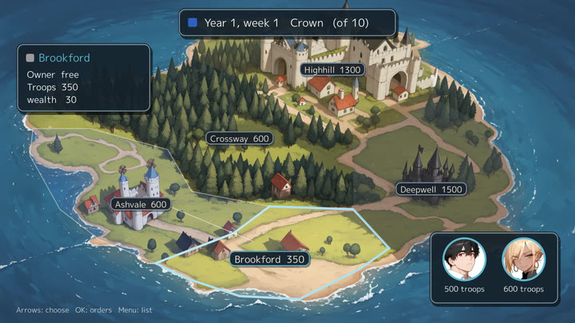 | 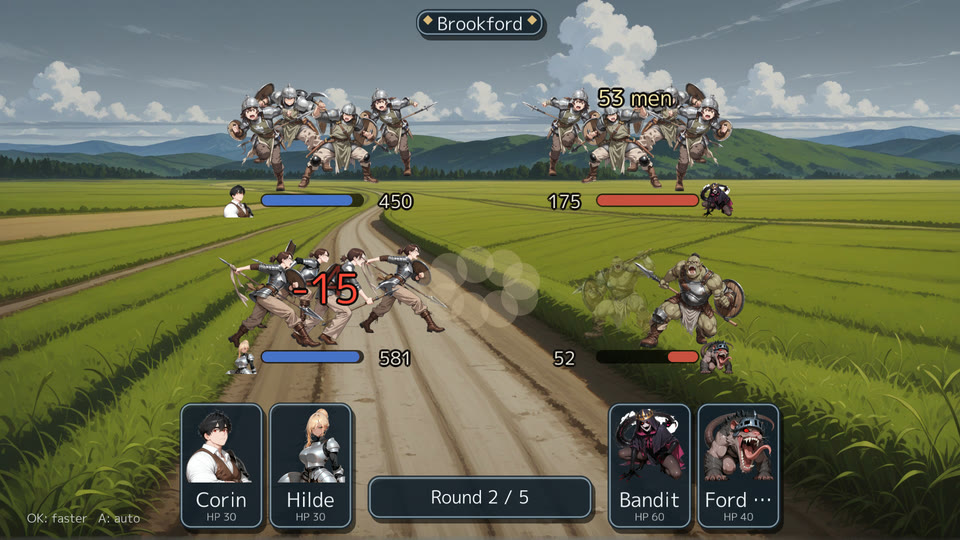 |
| A region's `area` and a point's `at` lay the regions on one picture of the land. | `clash.armies` gives each army kind its soldiers; each unit is a crowd that shrinks as it loses troops. |

`gozen sim campaign game` plays 200 campaigns and prints the win rate, the turns, the regions each side held turn by turn, and the orders given.

### Monster collection

Monsters ask to join after a battle, wait at the ranch, and two raised monsters, one male and one female, are bred into a new one at Yorn's altar, in the manner of Dragon Quest Monsters (schema version 6). The monster book (`ui.bestiary: true`) opens a page as the party meets each monster and shows how to breed it, two generations up.

| A monster asks to join | Breeding at Yorn's altar |
|:--|:--|
| 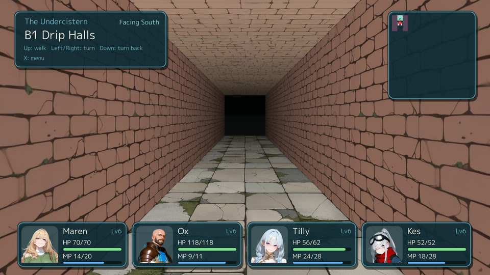 |  |
| The monster book | The family tree, two generations up |
| 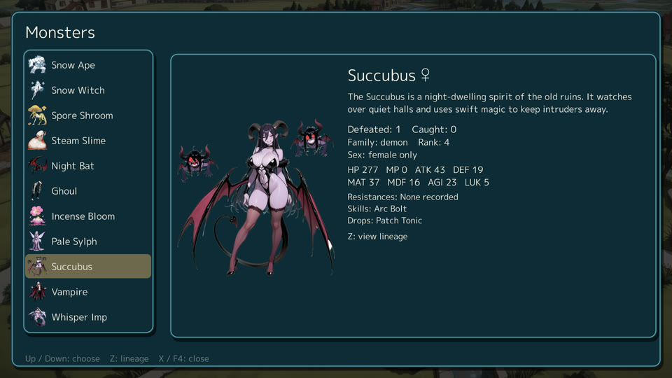 | 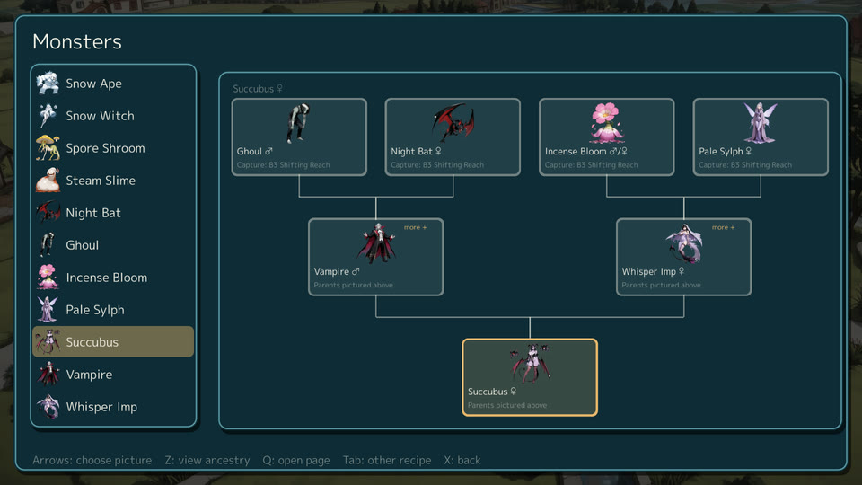 |

<!-- verify: parse the short enemy example lists the fields used by the monster book -->
```yaml
enemies:
  succubus:
    name: Succubus
    image: enemies/succubus.png
    lore: "A night-dwelling spirit of the old ruins, known for swift magic."
    stats: {mhp: 420, mmp: 20, atk: 56, def: 24, mat: 45, mdf: 23, agi: 24, luk: 5}
```

`gozen check game` finds breeding rules that can never work, and `gozen sim breed game` lists every monster reachable from the ones that can be caught, with the shortest recipe. See [Collect, raise and breed monsters](https://nao1215.github.io/gozen/cookbook/#collect-raise-and-breed-monsters).

### Battles

Enemies can change form at an HP threshold, combine with allies, change pictures as HP falls, and move with a puppet portrait. Go Zen shows the Tollkeeper's second form, Drip Slimes gathering into King Slime, and a moving Succubus face with a soft sway region (schema version 7).

| Transform | Merge |
|:--|:--|
| 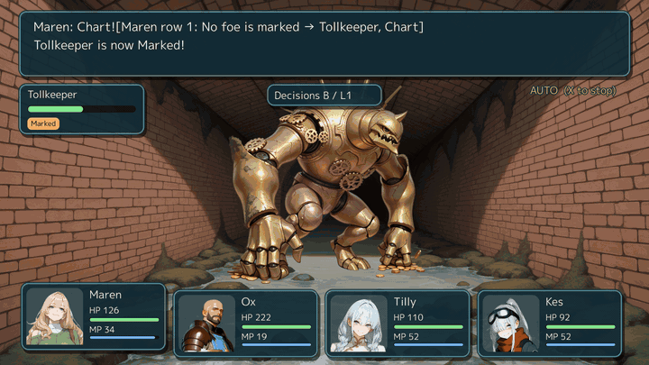 | 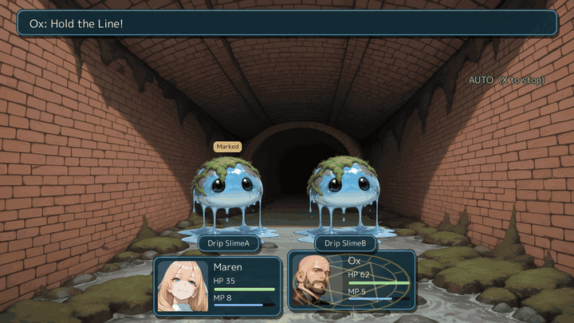 |
| Pictures by HP | Motion and sway |
| 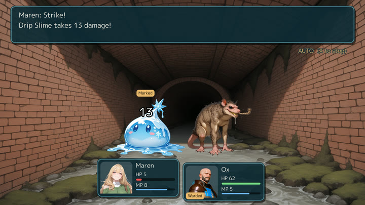 | 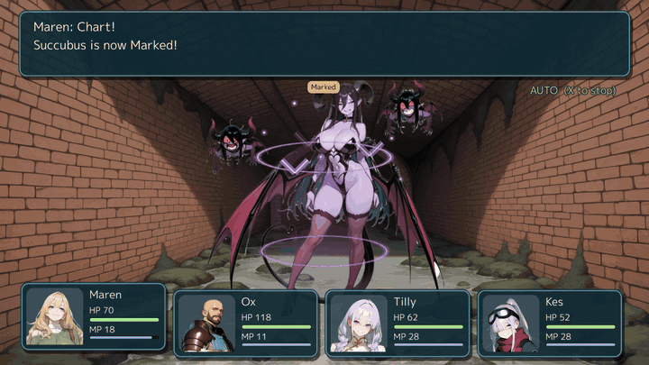 |

See [the battle recipes](https://nao1215.github.io/gozen/cookbook/#transform-an-enemy).

### Multi-level maps

[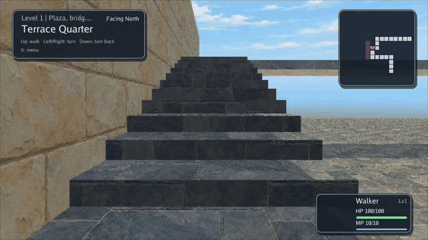](docs/media/stacked-space-short.mp4)

## Playtesting

Start the game with `--dev` and these keys work while you play.

<table>
<tr>
<th width="50%">F5: edit the YAML under <code>--dir</code>, the line changes in place</th>
<th width="50%">F9: a note with the screen and the state</th>
</tr>
<tr>
<td width="50%"></td>
<td width="50%"></td>
</tr>
<tr>
<td width="50%">F7: win rates of the battles here</td>
<td width="50%">F8 State: flip a flag, step a number</td>
</tr>
<tr>
<td width="50%"></td>
<td width="50%"></td>
</tr>
<tr>
<td width="50%">F8 Flags: what each event sets and reads</td>
<td width="50%">F8 Scenes: jump to an event</td>
</tr>
<tr>
<td width="50%"></td>
<td width="50%"></td>
</tr>
<tr>
<td width="50%">F8 Command: run a line of YAML</td>
<td width="50%">F8 Frames: ticks and frames a second, the slowest Update and Draw</td>
</tr>
<tr>
<td width="50%"></td>
<td width="50%"></td>
</tr>
<tr>
<td width="50%">F6: the character book, every page open: each character&#x27;s profile, faces and relations</td>
<td width="50%"></td>
</tr>
<tr>
<td width="50%"></td>
<td width="50%"></td>
</tr>
<tr>
<td width="50%">Tab: relationship chart; arrows choose a face, Z focuses its neighbors, Z again opens its page, and X returns to the full chart</td>
<td width="50%">Ox&#x27;s incoming and outgoing neighbors gather around him</td>
</tr>
<tr>
<td width="50%">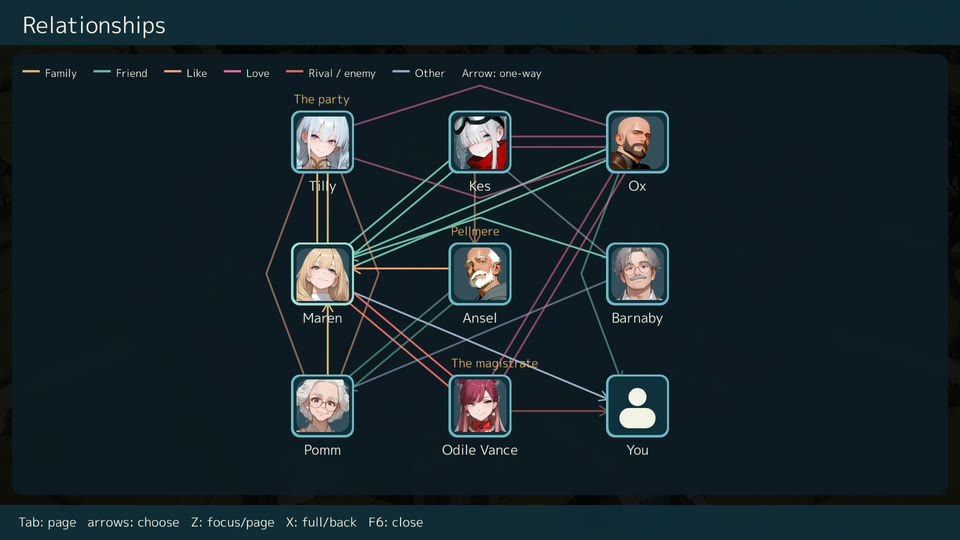</td>
<td width="50%">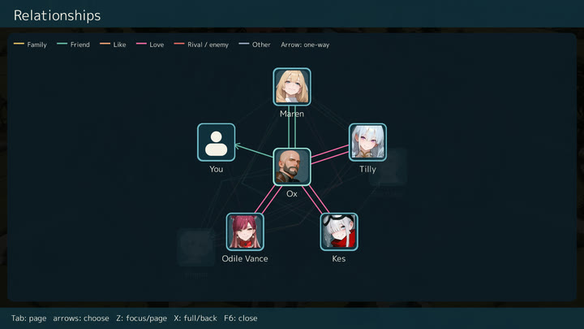</td>
</tr>
</table>

## Install

Go 1.26.10 or later:

```sh
go install github.com/nao1215/gozen/cmd/gozen@latest
```

With a C compiler, `CGO_ENABLED=1` adds the ONNX inference of `gozen mosaic`.

With Homebrew:

<!-- verify: skip installs from the Homebrew tap, outside the repository -->
```sh
brew install --cask nao1215/tap/gozen
```

[The release page](https://github.com/nao1215/gozen/releases) has archives for Linux, macOS and Windows (amd64, arm64) and `.deb`, `.rpm` and `.apk` packages. They have no ONNX inference.

The window needs the platform graphics libraries: [OS setup](https://nao1215.github.io/gozen/install/#what-the-window-needs).

In GitHub Actions, [setup-gozen](https://github.com/nao1215/setup-gozen) installs the release binary of the version in your `go.mod`, checked against the release checksums:

<!-- verify: skip runs in GitHub Actions -->
```yaml
- uses: actions/checkout@v6
- uses: nao1215/setup-gozen@1c378fc446f62ecb29a7bcd40aea6dff8565d698 # v0.1.1
- run: gozen check game
- run: gozen sim battle game --troop boss --format json  # boss: a troop id of your game
```

`version` also takes `latest` or a release such as `v0.2.0`, and `go-mod-path` points at a `go.mod` below the root. Without the action, `go run github.com/nao1215/gozen/cmd/gozen check game` builds the same version from `go.mod`.

## Recipes

Tested YAML recipes are in the [cookbook](https://nao1215.github.io/gozen/cookbook/).

With a coding agent, install the [gozen skill](skills/gozen/SKILL.md). It holds the schema links and one rule: run `gozen check` until it passes.

- Claude Code: copy `skills/gozen` to `~/.claude/skills/gozen`.
- Codex: copy `skills/gozen` to `~/.codex/skills/gozen`.

<!-- verify: run fixture=cave -->
```sh
gozen check game                                       # references, expressions, pictures, text layout
gozen sim battle game --troop cave_boss --level 8              # win rate at level 8
gozen sim dive game --location cave --floors 5 --boss 5:cave_boss # levels and wins per floor
```

`gozen book game > book.md` writes the whole game as one Markdown file.

Run the directory directly with `gozen run game`, or enable author tools with `gozen run game --dev`. No Go source is needed.

Test tools:

<!-- verify: skip opens a game window and waits for input -->
```sh
gozen run game --dev --memos notes                   # F9 note, F7 win rates, F5 reload
gozen run game --dev --start cave --level 8 --battle cave_boss  # jump to a fight
gozen run game --dev --autoplay 60 --speed 8 --trace run.jsonl  # autoplay and record
gozen trace run.jsonl                                # read the record
gozen notes notes --out notes-html                   # notes as one HTML page
```

## gozen

| Command | What it does |
|:--|:--|
| `new` | create a playable RPG, novel or campaign from a template |
| `check` | definitions, references, expressions, pictures, text layout (`--only structure` or `--only layout`) |
| `sim battle`, `sim dive`, `sim floors`, `sim design` | win rate; a dungeon dive; generated floors; scripted players |
| `run`, `trace`, `notes`, `capture` | run a game directory; read a trace; notes as HTML; screenshots of a list |
| `book` | the whole game as Markdown, JSON or JSONL |
| `export` | playable desktop directories; static browser games, using prebuilt runtimes |
| `release`, `trial` | approved pictures only; a demo |
| `prompt`, `mosaic`, `models fetch`, `faces`, `puppet` | image prompts; pixelation; models; balloon faces; moving portraits |
| `theme add`, `theme list` | copy a dungeon theme (walls, floor, ceiling, door) into a game; list the themes |
| `version`, `help` | the version; a command's help, or a diagnostic code |

`gozen help <command>` shows options and examples. `gozen help GZN1101` explains a code. [atago](https://github.com/nao1215/atago) tests every command end to end.

## Features

- YAML definitions with expressions, events and versioned saves
- Turn-based battles with a party, auto battle and enemy tactics
- Skill trees, shops, a field menu and a picture gallery
- First-person grid dungeons, fixed or generated, with themes (`theme: cave`, `gozen theme add`)
- Moving portraits from one picture ([portrait YAML](https://nao1215.github.io/gozen/cookbook/#give-a-character-faces-and-a-moving-portrait))
- Campaigns: regions held by factions over turns, orders with generals, a sortie screen with tactics, marches shown as clashes of armies (or decided by numbers or a battle), the other factions' rules, and `gozen sim campaign` ([recipes](https://nao1215.github.io/gozen/cookbook/#make-a-campaign))
- Visual novels: roll back, skip what was read, save in a scene, choices read as `chose`, staging with `stand` ([recipes](https://nao1215.github.io/gozen/cookbook/#let-the-player-roll-back-and-save-in-a-scene))
- Demo builds that cannot leak the full game: `gozen trial` keeps only what the range in `trial.yaml` reaches, so later events, endings and pictures are not in the demo at all ([recipe](https://nao1215.github.io/gozen/cookbook/#cut-a-release-and-a-trial))
- Engine words in English and Japanese (`language` in game.yaml), and the game's text in two languages (`lang/`)

## Limitations

- The supported interfaces are CLI commands, YAML definitions and saves. Go implementation packages are internal.
- Gameplay tests cover Linux, Windows and macOS. Browser E2E targets Chrome.
- There is no graphical editor.

## Contributing

See [CONTRIBUTING.md](CONTRIBUTING.md), the [Code of Conduct](CODE_OF_CONDUCT.md), [SUPPORT.md](.github/SUPPORT.md) and [SECURITY.md](SECURITY.md).

## Support

A star or a [GitHub Sponsors](https://github.com/sponsors/nao1215) sponsorship helps.

## License

The code is [MIT](LICENSE). The Go Zen, After the Pass and Five Banners pictures and music are CC BY 4.0 ([Go Zen](examples/go-zen/game/assets/LICENSE), [After the Pass](examples/novel/game/assets/LICENSE), [Five Banners](examples/campaign/game/assets/LICENSE)). Font notices are in [ASSETS.md](ASSETS.md).

## The name

Ebitengine is named after ebiten (海老天), shrimp tempura. In Japan, an ebiten gozen (御膳) is a set meal on one tray: shrimp tempura with soba, small side dishes, and a sweet such as dango. Gozen is that tray for Ebitengine: the engine served with everything an RPG needs. The name also starts with Go.

## Contributors ✨

Thanks goes to these wonderful people ([emoji key](https://allcontributors.org/en/reference/emoji-key/)):

<!-- ALL-CONTRIBUTORS-LIST:START - Do not remove or modify this section -->
<!-- prettier-ignore-start -->
<!-- markdownlint-disable -->
<table>
  <tbody>
    <tr>
      <td align="center" valign="top" width="14.28%"><a href="https://debimate.jp/"><br /><sub><b>CHIKAMATSU Naohiro</b></sub></a><br /><a href="https://github.com/nao1215/gozen/commits?author=nao1215" title="Code">💻</a> <a href="https://github.com/nao1215/gozen/commits?author=nao1215" title="Documentation">📖</a></td>
    </tr>
  </tbody>
</table>

<!-- markdownlint-restore -->
<!-- prettier-ignore-end -->

<!-- ALL-CONTRIBUTORS-LIST:END -->

This project follows the [all-contributors](https://github.com/all-contributors/all-contributors) specification. Contributions of any kind are welcome.
