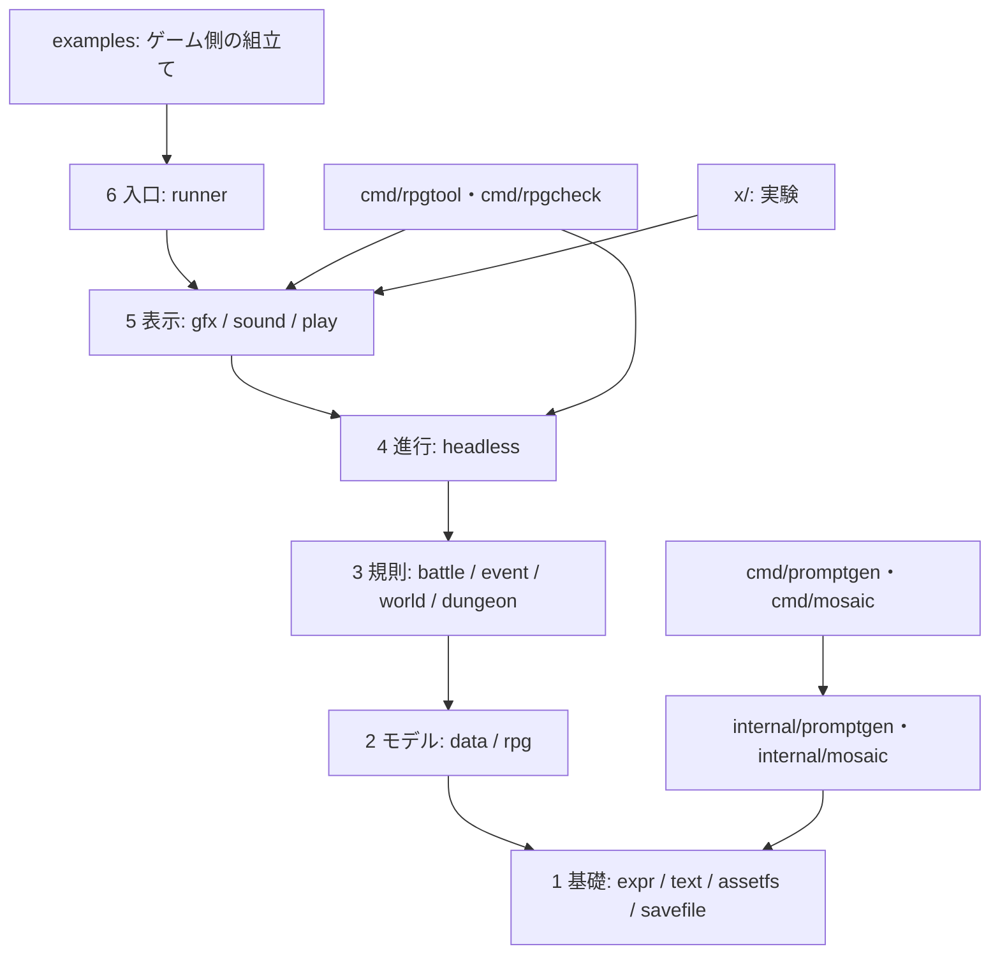

# 全体設計

Gozen はゲームの定義・状態・規則・進行を画面から分離し、同じ中核をライブラリ、描画なしの実行、ゲーム画面、検査 CLI から利用できる構成にします。T2 で描画しない中核を実装しました。利用可能な契約と所有権は [中核 API](core-api.md) を参照してください。T3 で表示・音声・起動を実装しました。[表示 API](presentation-api.md) に契約を記載します。

モジュールは `github.com/nao1215/gozen` の 1 つです。Go の下限は 1.26.4。採用する直接依存の宣言は `go.mod:1` にあります。4 つの CLI は `cmd/`、制作支援の実装は `internal/promptgen/`・`internal/mosaic/` に置きます。`go.work` とローカル参照用の `replace` は使いません。配置は [ADR 0001](../decisions/0001-modules-and-layout.md)、単一モジュールへの変更理由は [ADR 0009](../decisions/0009-single-module.md) に記録します。

## 層と依存

矢印は許される依存の向きです。上位は任意の下位を参照できます。同じ段の別の公開パッケージへの依存は許可しません。

`savefile` は状態や定義を知らない保存先・バイト列の基礎として第 1 層に置きます。`dungeon` の実装は `internal/layer3/dungeon` に置きます。SW2 で独自の探索操作に必要な公開入口を追加しました。用途と範囲は [ADR 0014](../decisions/0014-dungeon-host-adoption.md) を参照してください。

表示パッケージ間の呼出しも横依存に含まれます。たとえば `play` から `gfx` へ直接 import する構成は採りません。共有の実装は所有層を付けた `internal/` に寄せ、組立ては上位に置きます。`rpg` と `data`、規則同士でも同じ方針です。共有の型や処理も、依存方向に従って所有者を決めます。

Ebitengine の import は第 5・6 層だけです。CLI とサンプルは必要な表示を組み立てる入口として利用できますが、中核から表示を参照する経路は作りません。`x/` は安定パッケージから利用しません。

機械検査の正本は `.go-arch-lint.yml:1` です。各公開パッケージを独立した component にし、同段をまとめて許可しません。テストの組立ては runtime の依存検査から外し、`internal/dev/` は標準ライブラリだけを使う開発道具として扱います。詳しくは [境界](boundaries.md) と [ADR 0008](../decisions/0008-architecture-and-api.md) を参照してください。

## 起動と拡張

ゲーム側は自分の `fs.FS`、データ、素材を用意し、`runner` に渡して起動する設計です。描画なしの操作は `headless` を使います。`headless` の実行例は `examples/headless`、`runner` の実行例は `examples/play`、最小の埋込み例は `examples/minimal` にあります。T6 でサンプルの進行・保存復元と日英 README、再現できる撮影を追加しました。[サンプルガイド](../examples/wayfinder.md) を参照してください。読み込み、設定、エラー、拡張点の形は [API 規約](api-guidelines.md) に揃えます。

作品固有のデータと拡張はゲーム側が所有します。公開 API だけで起動から保存・復元まで組み立てられることを、サンプルと契約テストで確認します。

T2 の共有モデルは `internal/layer2/gamedata`、素材の制作記録は `internal/layer2/assetpolicy`、到着・遭遇の共通規則は `internal/layer3/field` が所有します。公開パッケージ間の横依存や共有 callback の登録を避ける判断は [ADR 0010](../decisions/0010-core-ownership.md) に記録します。

T3 の描画・音声の共有実装は `internal/layer5/gfx`・`internal/layer5/sound`、画面実装は `internal/play`、汎用メモ記録は `internal/layer1/memo` が所有します。起動と終了、単一 Game の制約は [ADR 0011](../decisions/0011-presentation-ownership.md) に記録します。

T4 で `rpgcheck` と `rpgtool` の 12 サブコマンドを実装しました。CLI だけの解析・シミュレーションは `cmd/internal/` と `cmd/rpgtool/internal/` に置き、安定 API は増やしません。[ADR 0012](../decisions/0012-cli-ownership-and-output.md) と [CLI の使い方](../development/cli.md) を参照してください。

T5 で制作支援の `promptgen` と `mosaic` を専用 internal に実装しました。ONNX binding は mosaic component だけが利用し、公開 API と既存の層の許可は増やしません。4 CLI が同じ `./...` と CLI E2E の対象です。[制作支援 CLI](../development/production-tools.md) に入出力と前提を記載します。

SW1 で戦闘前後の共通イベントと可変メーター上限を追加しました。実行順と CLI の扱いは [戦闘イベントとメーター](battle-hooks.md)、公開する3フィールドの利用目的は [ADR 0013](../decisions/0013-battle-hooks-and-meter-limits.md) に記載します。

利用側の呼び出し・保存先・CLI 検査の切り替えは [ゲームから Gozen を利用する](adoption.md) を参照してください。
