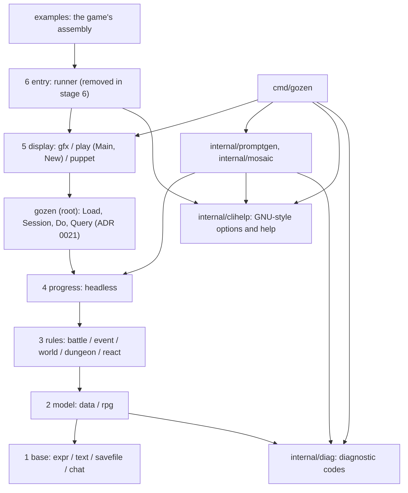

# Overall design

The meaning of the symbols of the initial implementation stages (T1 to T7, SW1 and SW2, D1 to D10) is in [the symbols of design decisions](../decisions/index.md#symbols).

Gozen separates a game's definitions, state, rules and progress from the screen, so that the same core can be used from a library, a run without rendering, a game screen and a checking CLI. T2 implemented the non-rendering core. For the available contracts and ownership see [the core API](core-api.md). T3 implemented display, sound and startup; the contracts are in [the presentation API](presentation-api.md).

The module is the single `github.com/nao1215/gozen`. The lower bound of Go is 1.26.10. The declaration of the direct dependencies in use is at `go.mod:1`. The CLI is the single `cmd/gozen`, and the authoring-support implementations are in `internal/promptgen/` and `internal/mosaic/` ([ADR 0016](../decisions/0016-single-cli.md)). `go.work` and a `replace` for local references are not used. The layout is in [ADR 0001](../decisions/0001-modules-and-layout.md), and the reason for moving to a single module is recorded in [ADR 0009](../decisions/0009-single-module.md).

## Layers and dependencies

Arrows are the allowed directions of dependency. A higher layer may reference any lower one. A dependency on another public package in the same layer is not allowed.

The names in the figure correspond to the components of `.go-arch-lint.yml` as follows. Each public package is a component of the same name. `internal/layerN/` is `privateN` (the shared implementation of layer N), `cmd/gozen/**` and `cmd/internal/**` are `commands`, `internal/promptgen/**` and `internal/mosaic/**` are `promptgen` and `mosaic`, `internal/clihelp/**` is `clihelp`, `internal/diag/**` (the diagnostic codes) is `diag`, the root `gozen` is `gozen` (above layer 4, below display), and `x/**` is `experiments` (there are no experiments now, and no directory either). Swapping assets (`internal/layer1/assetfs`) and loading sound effects (`internal/layer5/sound`) are not published and live in the shared implementation of their layers ([ADR 0021](../decisions/0021-query-and-commands.md)). `internal/dev/**` (`dev`) uses only the standard library and `diag`, and `internal/testgame/**` (`testgame`) uses only layers 1 and 2. If the figure and the configuration disagree, the configuration is right and the figure is fixed. When you add a component, fix this figure and the paragraph of correspondence in the same change.

`savefile` is in layer 1 as a base of save locations and bytes that knows nothing of state or definitions. The implementation of `dungeon` is in `internal/layer3/dungeon`. SW2 added the public entry needed for custom exploration operations. For its purpose and scope see [ADR 0014](../decisions/0014-dungeon-host-adoption.md).

Calls between display packages also count as lateral dependencies. For example, `play` importing `gfx` directly is not the structure we take. Shared implementation moves to `internal/` with an owning layer, and assembly goes higher. The same policy holds for `rpg` and `data`, and between rules. Shared types and processing also get an owner following the direction of dependency.

The Ebitengine import is only in layers 5 and 6. The CLI and the samples may be used as entries that assemble the display they need, but no path from the core to the display is made. `x/` is not used from stable packages.

The authority for the mechanical check is `.go-arch-lint.yml:1`. Each public package is an independent component, and the same layer is not allowed as a group. Test assembly is excluded from the runtime dependency check, and `internal/dev/` is treated as a development tool that uses only the standard library. For details see [the boundaries](boundaries.md) and [ADR 0008](../decisions/0008-architecture-and-api.md).

## Startup and extension

The design is that the game provides its own `fs.FS`, data and assets and passes them to `play.Main` (for your own loop or a browser, pass a `gozen.Session` to `play.New`). For operation without rendering use `headless`. The run example of `headless` is `examples/headless`, that of `play.Main` and `play.New` is `examples/go-zen` (the sample game, a module of its own), and the minimal embedding example is `examples/minimal`. The shapes of loading, settings, errors and extension points follow [the API conventions](api-guidelines.md).

Work-specific data and extensions are owned by the game side. That a game can be assembled from startup through save and restore with the public API alone is confirmed by the sample and the contract tests.

The shared model of T2 is owned by `internal/layer2/gamedata`, the production record of assets by `internal/layer2/assetpolicy`, and the common rules of arrival and encounter by `internal/layer3/field`. The decision to avoid lateral dependencies between public packages and the registration of shared callbacks is recorded in [ADR 0010](../decisions/0010-core-ownership.md).

The shared implementation of drawing and sound in T3 is owned by `internal/layer5/gfx` and `internal/layer5/sound`, the screen implementation by `internal/play`, and the generic memo recording by `internal/layer1/memo`. Startup, exit and the single-Game constraint are recorded in [ADR 0011](../decisions/0011-presentation-ownership.md).

`gozen` has six tools, `check`, `sim`, `play`, `book`, `pack` and `art`, plus `version` and `help` ([ADR 0024](../decisions/0024-command-tree-and-diagnostic-codes.md)). The authoring support is `art prompt` and `art mosaic`. Analysis and simulation used only by the CLI are in `cmd/internal/` and `cmd/gozen/internal/`, and the stable API is not increased. The win-rate calculation is shared by the CLI and the development balance display (F7), so it is in `internal/headless/balance`, owned by `headless` ([ADR 0017](../decisions/0017-dev-balance-panel.md)). See [ADR 0012](../decisions/0012-cli-ownership-and-output.md) and [the commands](https://nao1215.github.io/gozen/commands/).

The authoring-support `gozen art prompt` and `gozen art mosaic` are implemented in the `command` package of a dedicated internal, and `cmd/gozen` only dispatches. The ONNX binding is used only by the mosaic component, and neither the public API nor the existing layer permissions grow. All subcommands of `gozen` are under the same `./...` and CLI E2E. Inputs, outputs and prerequisites are in [the production tools](https://nao1215.github.io/gozen/production-tools/).

SW1 added common events before and after a battle and a variable meter limit. The order of execution and the CLI handling are in [battle events and meters](battle-hooks.md), and the purpose of the three public fields is in [ADR 0013](../decisions/0013-battle-hooks-and-meter-limits.md).

Enemy transformations, merging, HP pictures and battle motion are described in [battle forms](battle-forms.md) and [ADR 0037](../decisions/0037-battle-forms-and-motion.md).

Character reactions (`react`) and chat (`chat`) were added. They are a mechanism that reacts to words and happenings without an LLM, and a record of flowing messages. Their purpose and API are recorded in [ADR 0015](../decisions/0015-reaction-and-chat.md).

`puppet` (layer 5), which moves a one-picture character, was added. The implementation of compositing difference pictures and mesh deformation is in `internal/layer5/puppet`, and the YAML types and validation in `internal/layer2/puppetdef`. See [moving portraits](puppet.md) and [ADR 0020](../decisions/0020-moving-portraits.md).

A map (`map:`) and a painted scene (`stage:`) were added as ways to show a location. The only position the rules know is the standing point (`State.Spot`); the geometry of points and polygons is owned by `internal/layer1/geom`, and the rules of roads and standing points by `internal/layer3/atlas`. See [maps and painted scenes](scenes.md) and [ADR 0022](../decisions/0022-maps-and-painted-scenes.md).

Novel games are games whose places show events in the novel window (`ui.message: novel`); they are not a new kind of game. Rolling back, skipping a scene, jumping and resuming a save made in the middle of an event all replay an event from the state saved at its start ([ADR 0025](../decisions/0025-replay-to-roll-back-skip-and-resume.md)). Read lines are keyed by their source text and kept by the screen, not by the rules ([ADR 0026](../decisions/0026-read-lines-and-skipping.md)). The languages of a game's text, staging and voice, and the development panel are in [ADR 0027](../decisions/0027-text-languages.md), [ADR 0028](../decisions/0028-staging-and-voice-words.md) and [ADR 0029](../decisions/0029-dev-panel.md). Their YAML words need `schema_version: 4`.

A campaign is a game of regions held by factions over turns, with its own YAML words (`regions`, `factions` and `campaign` in `game.yaml`, `schema_version: 5`). Its state is in variables with generated names, read by the expression names `region`, `faction`, `campaign`, `generals`, `general`, `target` and `next_to` ([ADR 0030](../decisions/0030-campaigns.md)).

For switching a using module's calls, save location and CLI checks, see [using Gozen from a game](adoption.md).
