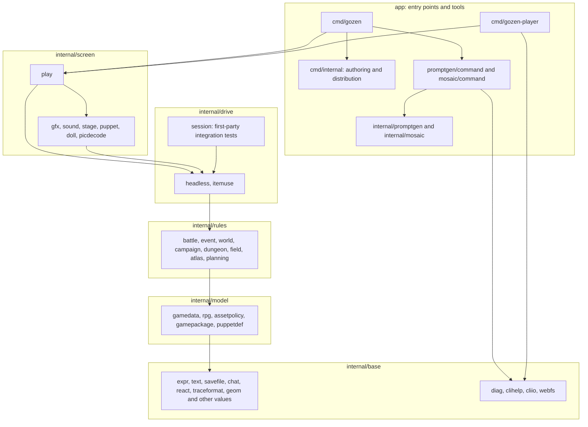

# Overall design

Authors create games with YAML and assets. The supported interfaces are CLI commands, YAML schema versions, game identity and save formats. Go and Ebitengine implement the toolkit; application packages live under `internal/` ([ADR 0041](../decisions/0041-yaml-authoring-and-distribution.md)).

The dependency order has six named levels, ordered once in `internal/dev/hygiene/levels.go` ([ADR 0064](../decisions/0064-named-dependency-levels.md)): `base` (values, expressions, texts, save bytes, chat, conversation rules, diagnostics and shared CLI and browser I/O), `model` (definitions and state), `rules`, `drive` (running without a screen), `screen` (drawing, sound and the player) and `app` (commands and tools). `.go-arch-lint.yml` is the dependency authority between components; `go tool dango lint` checks that every component has one level and depends on no higher level. Each engine level is a directory (`internal/base`, `internal/model`, `internal/rules`, `internal/drive`, `internal/screen`) that holds all of its packages, named components (`expr`, `text`, `savefile`, `chat`, `react`, `diag`, `clihelp`, `cliio`, `webfs`, `rpg`, `battle`, `event`, `world`, `headless`, `session`, `play`) included; the level component (`base` and so on) covers the other packages of its directory. The `app` level keeps its places (`cmd/`, `internal/promptgen`, `internal/mosaic`, `internal/dev`, `internal/testgame`). Sibling implementation packages share code through an owning lower level.

`commands` covers `cmd/gozen` and its authoring support packages. `repro` owns the shared reproduction-bundle operation; `dango` is a separate maintainer entry point. Both consume the foundation trace protocol in `internal/base/traceformat`, which the player also uses for exact-replay validation. `player` is the private desktop/browser startup. `promptcmd` and `mosaiccmd` are CLI adapters, separate from their domain components. Domain code cannot import command parsing or reporting. `dev` owns repository tooling; `testgame` owns neutral fixtures. The standalone portrait example is a maintainer inspection tool. Tests may assemble levels; production code may not use that exception.

`internal/model/gamedata` owns YAML types, validation and the directory loader. `internal/model/rpg` owns state and save serialization. `internal/base/savefile` owns save locations and byte stores. `internal/drive/session` retains non-rendering sessions for first-party integration tests; its former public wrappers and the session-to-screen bridge are removed. See [session contracts](core-api.md) and [presentation](presentation-api.md).

`gozen run GAME` and `cmd/gozen-player` use the same internal runtime. Desktop exports locate `game/` beside the player. Browser exports fetch the page-relative manifest through `internal/base/webfs`; saves use origin-local storage. Export selects files and validates matching runtime metadata in `cmd/internal/distribute`. Authors do not compile game-specific code.

`gozen capture` calls a typed internal batch renderer, runs one Ebitengine loop, and writes PNG or GIF artifacts. Handlers do not call another subcommand or reconstruct its argv. CLI reporting and diagnostic classification belong to `internal/base/cliio` and `internal/base/diag` ([ADR 0042](../decisions/0042-command-and-output-contract.md)).

The engine retains YAML features for battles, novels, campaigns, maps and stacked spaces. Package moves do not change schema or save versions. See [battle forms](battle-forms.md), [maps and painted scenes](scenes.md), and the [stacked-space demo](../examples/stacked-spaces.md). Narrative speakers need no combat class or party. YAML command aliases call events, author screens display conditional entries with optional event commands, and `respond` uses reaction books through the ordinary dialogue and save flow ([ADR 0043](../decisions/0043-narrative-authoring.md)). The standalone chat implementation remains internal; dialogue history has one owner. Markdown reports use `github.com/nao1215/markdown` in CLI adapters and the reference-page generator. Runtime diagnostics expose plain entries and terminal text, so browser players do not depend on a filesystem-oriented report library.

[Phone games](phone-games.md) describes phone hosting, the package registry and installation.
