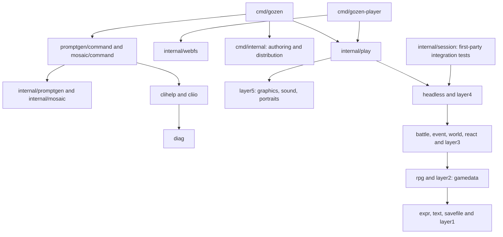

# Overall design

Authors create games with YAML and assets. The supported interfaces are CLI commands, YAML schema versions, game identity and save formats. Go and Ebitengine implement the toolkit; application packages live under `internal/` ([ADR 0041](../decisions/0041-yaml-authoring-and-distribution.md)).

`.go-arch-lint.yml` is the dependency authority. `private1` through `private6` map to `internal/layerN/**`. Named components (`expr`, `text`, `savefile`, `chat`, `rpg`, `battle`, `event`, `world`, `react`, `headless`, `session`, `play`, `webfs`, `clihelp`, `cliio`, `diag`) map to their internal directories. Higher layers may depend on permitted lower layers; sibling implementation packages share code through an owning lower layer.

`commands` covers `cmd/gozen` and `cmd/internal`; `player` is the private desktop/browser startup. `promptcmd` and `mosaiccmd` are CLI adapters, separate from their domain components. Domain code cannot import command parsing or reporting. `dev` owns repository tooling; `testgame` owns neutral fixtures. The standalone portrait example is a maintainer inspection tool. Tests may assemble layers; production code may not use that exception.

`internal/layer2/gamedata` owns YAML types, validation and the directory loader. `internal/rpg` owns state and save serialization. `internal/savefile` owns save locations and byte stores. `internal/session` retains non-rendering sessions for first-party integration tests; its former public wrappers and the session-to-screen bridge are removed. See [session contracts](core-api.md) and [presentation](presentation-api.md).

`gozen run GAME` and `cmd/gozen-player` use the same internal runtime. Desktop exports locate `game/` beside the player. Browser exports fetch the page-relative manifest through `internal/webfs`; saves use origin-local storage. Export selects files and validates matching runtime metadata in `cmd/internal/distribute`. Authors do not compile game-specific code.

`gozen capture` calls a typed internal batch renderer, runs one Ebitengine loop, and writes PNG or GIF artifacts. Handlers do not call another subcommand or reconstruct its argv. CLI reporting and diagnostic classification belong to `internal/cliio` and `internal/diag` ([ADR 0042](../decisions/0042-command-and-output-contract.md)).

The engine retains YAML features for battles, novels, campaigns, maps and stacked spaces. Package moves do not change schema or save versions. See [battle forms](battle-forms.md), [maps and painted scenes](scenes.md), and the [stacked-space demo](../examples/stacked-spaces.md). Standalone chat and reaction implementations remain internal; no unused YAML scripting layer was added for them.
