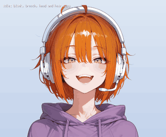

# Moving portraits (puppet)



A one-picture character is moved by blinking, mouth movement, breathing, head sway and tilt, swaying parts such as hair, ribbons and hems, one-shot reactions and face changes. For the decision and the alternatives see [ADR 0020](../decisions/0020-moving-portraits.md).

## Usage

The calls (`puppet.Load`, `puppet.New`, `Update`, `Speak`, `React`, `SetFace`, `Draw`) and the `puppet:` key of an actor are shown in [Moving portraits: puppet](https://nao1215.github.io/gozen/go-api/#moving-portraits-puppet) in the Go API guide. In `Draw`, `rig.Size()` gives the size of the base picture, which you scale and translate to place it.

A running example is `go run ./examples/puppet` (the streamer from the chest up; Space starts and stops talking, H, S, K, N and T are reactions, F is the face). `--tour --frames DIR` shows all the motions in order and writes 30 fps PNGs (the source of the GIF above; on Linux it runs inside `xvfb-run`).

Puppet is used only from the game thread. One `Update` advances `1/TPS` seconds (the default of `Config.TPS` is Ebitengine's default of 60). The same random seed and the same sequence of calls give the same motion. Call `Close` when taking it off the screen.

The head, hair and swaying parts can extend beyond the base picture by some tenths of the head radius, and hop and sway move the whole picture. Leave a little margin on top and on both sides when placing it.

## Talk portraits in an RPG

Writing `puppet` on a party member (actors) makes the talk window's portrait that puppet.

```yaml
actors:
  walker: {name: Walker, class: walker, faces: walker, puppet: walker/puppet.yaml}
```

- The path is relative to `assets/`. Name the puppet's faces the same as the faces of the lines (the `<face>` of `assets/<faces>/<face>.png`). A line whose face the puppet does not have shows the face picture as before.
- The mouth moves only while text is appearing, and consecutive lines of the same person change the face softly. The handling of size is the same as for tall portraits (fit to the screen height).
- The randomness is determined from the party member's ID and does not use the game's randomness (so it does not affect reproducing a recording). It is rebuilt on an F5 reload.
- `data.Load` (`gozen check --only structure`) checks the YAML, the existence of the picture files, and that the party member's `face` exists in the puppet; `gozen check` also checks the size and position of the pictures.
- Portraits in menus, battles and cut-ins do not move (they stay as the face picture).

## Pictures to prepare

| Picture | Content |
| --- | --- |
| Base picture | A transparent PNG (or WebP, which a browser build uses to download less). It doubles as one of the faces (often the usual face) |
| Closed eyes | A picture with eyes closed. It may be a whole picture the same size as the base, or a small picture of only the eye part (placed at `at`) |
| Mouth shapes | Closed, half open and so on. The mouth of the base picture can also be used as one shape (`face`) |
| Other faces | A whole picture, or a small picture of only the parts that differ |

A whole picture is compared at load time with the base (for the eyes or mouth of a face, with that face's picture), and only the differing part is cut out, with the edge blurred by about 16 pixels. A picture whose whole was redrawn by image generation differs slightly everywhere, so use `area` (`[x, y, w, h]`) to narrow the search range to around the eyes or mouth. For a picture without transparency (drawn with a background), the transparency of the picture beneath is used as it is.

`gozen puppet <puppet.yaml>` checks the position of each difference. `--out DIR` writes the small pictures with the differences cut out and a YAML with `at`, which makes the distributed files smaller (comments do not remain in the written YAML).

## YAML

All coordinates are pixels of the base picture (origin at the top left). Picture paths are relative to the directory of the YAML. Unknown keys are an error.

```yaml
base: streamer.png
face: smile              # the first face. Required if there are 2 or more faces
fade: 0.25               # seconds for a face change
faces:
  smile: {}              # the base picture as it is
  surprised:
    image: surprised.png # a whole picture (the differing parts are cut out)
    area: [420, 380, 520, 420]
    eyes: {off: true}    # this face does not blink (the shape of the eyes differs)
eyes:
  closed: {image: eyes_closed.png, area: [420, 490, 560, 170]}
  every: [2, 5.5]        # seconds between blinks (shortest, longest)
  double: 0.25           # probability of blinking twice in a row
mouth:
  frames:                # switched irregularly while talking (2 or more)
    - {image: mouth_closed.png, at: [564, 714]}  # a small picture is placed with at
    - mouth_half.png                            # a whole picture may be just a path
    - face                                      # the mouth of the face picture as it is
  speed: 11              # switches per second
head:
  center: [690, 520]     # center of the head. The circle should cover the head including hair
  radius: 400
  neck: [690, 1090]      # the base of the neck. The head turns around it. Below center
hair:                    # hair that sways behind the head. The lower, the more it moves
  - rect: [200, 330, 290, 700]          # [x, y, w, h]
  - poly: [[860, 330], [1190, 330], [1190, 1030], [860, 1030]]
springs:                 # swaying parts. Ribbons, hems, sleeves, cords and so on. A later part in the list lies over earlier parts and the hair
  - rect: [520, 1100, 120, 300]         # the area ([x, y, w, h] or poly)
    root: top            # the root. top, bottom, left, right (edges of the area) or [x, y]. Default top
    follow: body         # what it follows. head (the offset between head and body, like hair) or body (the whole body, as in breathing and hop). Default head
    axis: both           # the direction of sway. x, y, both. Default both
    stiffness: 40        # the stiffness of the spring (default 60) and damping (default 7)
    damping: 4
    amount: 1            # multiplier of the lag (default 1)
    limit: 30            # upper bound of the lag (pixels. Default 15% of the head radius)
  - {poly: [[300, 40], [360, 40], [330, 160]], root: [330, 160]}  # the root as a point (e.g. hair tips attached below)
soft_sway:               # gentle regions for an actor or enemy; the same spring settings as above
  - {ellipse: [490, 760, 240, 160], root: top, follow: body, axis: y, amount: 1.2, limit: 8}
motion:                  # omitted groups take the defaults. A strength of 0 inside a group stops that motion
  hit: soft_only         # optional: a hit moves only soft_sway regions; the default uses a whole-body reaction
  breath: {depth: 0.006, period: 3.8}   # vertical stretch (ratio of height) and period in seconds
  sway: {angle: 2.5, shift: 10, period: 6.5, damage_boost: 0}  # head sway; damage_boost increases strength and speed at low HP
  tilt: {angle: 7, every: [5, 11]}      # an occasional head tilt
  hair: {gain: 1, stiffness: 60, damping: 7}  # the spring of the hair
  talk: {nod: 8}                        # up and down of the head while talking (pixels)
reactions:               # named variants of strength. The built-in names can be used as they are
  jump: {kind: hop, amount: 1.6}
  nod: {time: 0.7}
```

| Item | Default | Validation |
| --- | --- | --- |
| `faces` | one `default` if omitted (the base picture) | `at` and `area` go with `image`. `face` is a name in faces |
| `eyes`, `mouth` | none (does not move) | can be overridden per face, and `off: true` stops them. `frames` is 2 or more |
| `eyes.every`, `double` | `[2, 6]`, 0.2 | positive and ascending, 0 to 1 |
| `mouth.speed` | 10 | 0 or more |
| `head` | none (no head, hair, tilt or talk motion) | `radius` is positive, `neck` is below `center` |
| `hair` | none | needs `head`. A rectangle has a positive size, a polygon 3 or more points |
| `springs` | none | the area is the same as for `hair`. `follow: head` (default) needs `head`. `root`, `follow` and `axis` are the words above or a point. `stiffness` up to 10000, `damping` up to 1000, numbers 0 or more. Up to 16 together with `hair` |
| `motion.sway.shift`, `talk.nod` | 2.5% and 2% of the head radius | 0 or more. The angle up to 45 degrees, `breath.depth` up to 0.2 |
| `motion.sway.damage_boost` | 0 (off) | Nonnegative. Lower HP increases sway size and speed; a hit adds a brief bounce and lingering sway. |
| `motion.hit` | whole-body response | `soft_only` requires `soft_sway`; damage drives only those regions, without a hit hop or shake of the picture. |
| `reactions` | the built-in hop, shrink, shake, nod, tilt, freeze (temporarily stops breathing, sway, blinking and mouth) | `kind` is one of the built-ins. `amount` (multiplier, default 1) and `time` (seconds) are 0 or more |

Picture errors (missing, not a PNG or WebP, larger than 8192 pixels, sticking out of the base, a whole picture whose size differs from the base, no differing part) are returned by `Load` with a location.

## Swaying parts (springs)

A part follows the motion of what it follows (head or body) with a lag through a spring (stiffness and damping). The area of the part is warped by a mesh by the amount of the lag, and the farther from the root, the more it moves (the edge at the root gets 15% of the lag, the opposite end all of it). A point root is measured by the distance from that point to the farthest corner of the area.

- `follow: head` follows the movement of the head's center and the offset of the body (hop, shake). The parts outside the head circle also move with the head. `follow: body` follows where the root point moves under breathing, hop, shrink and shake, so a part attached low on the body sways behind the up and down of the body. Both stop during freeze.
- The default strength is small (the lag is up to 15% of the head radius; 3% of the height when there is no head). To sway a lot, raise `amount` and `limit`.
- The edge of the area is blurred inward (8% of the head radius). Since it is joined by mesh triangles, it blends out of the area on the picture by up to one mesh cell (1/48 of the long side, at least 8 pixels). Take the area of a thin part a little wider.
- Where they overlap, the later part in the list decides (it replaces the earlier part's motion by the extent of the later part's area). `hair` is at the head of the list.
- `hair` moves the same as a part with the defaults of `springs` (`root: top`, `follow: head`) (unless the shapes overlap. The several shapes of `hair` share one spring, and the larger weight is used where they overlap). `motion.hair` affects only the spring of `hair`.
- `soft_sway` accepts the same settings as `springs` and is drawn after them. It is suitable for a gently moving area of an actor or enemy puppet. Use `rect: [x, y, width, height]` or `ellipse: [x, y, width, height]` with `follow: body` to trail breathing and whole-body reactions. The coordinates are pixels in the base image.
- With `motion.hit: soft_only`, damage gives the `soft_sway` regions a stronger, lingering oscillation as HP falls. Other regions keep their idle motion, and the battle screen omits its hit shake for that enemy.
- The same random seed and the same sequence of calls give the same sway. With a stiff spring or a small TPS, one Update is computed in finer sub-steps.
