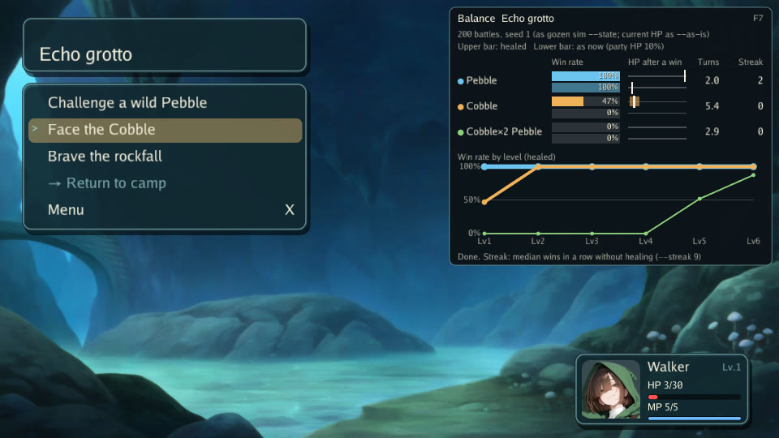

# 画面の開発と検証

Go 1.26.4 以降を使う。T3 の通常テストは表示・音声デバイスを起動しない。実描画は `graphics` tag の別テストで確認する。公開前の確認項目は [リリース点検](release-checklist.md) を参照する。

## オリジナルのサンプル

```sh
go run ./examples/play --mute
go run ./examples/play --help
go run ./examples/play --dev --mute --start camp --seed 7
```

Wayfinder は独自の小さなサンプル。キャンプで会話・練習戦闘を行い、道標を灯して尾根へ進み、保存・復元を試す。尾根と村で仲間が加わり、観測の回廊（一人称の迷宮）では宝箱・見張りとの戦闘（カットイン）・門を開ける仕掛けを試す。遊び方と Xvfb による PNG・GIF の再生成は [サンプルガイド](../examples/wayfinder.md) を参照する。通常起動の保存は OS の config ディレクトリ配下の `gozen/wayfinder-demo`。開始位置指定の試走は保存先を省略すると一時保存になる。素材とフォントの出典は [素材台帳](../examples/play-assets.md) に記載する。

`runner.Run` が受ける起動オプションは `gozen` と同じ GNU 形式（[ADR 0018](../decisions/0018-gnu-options-and-help.md)）。`--seed 7` と `--seed=7` を受け、`-dev` のような単一ダッシュの長い名前はエラーになる。`--help` は `[Usage]`・`[Examples]`・種類ごとの `[Options]`（ゲーム、試走、自動操作、スクリプトと記録、メモと見直し）・`Requirements:`・リンクの形で、`--dev` が要るオプションはまとまりの名前に `(--dev)` と書く。

埋込み FS の作り方と終了コードの扱いは `examples/play/main.go`、API の契約は [表示 API](../architecture/presentation-api.md) を参照する。ライブラリがプロセスを終了することはない。

## Requirements

Ebitengine v2.10.4 の通常ビルドは pure Go。race detector には cgo と C コンパイラが必要。Linux ではコンパイル時に cgo を無効化しても、実行時の X11・OpenGL・音声ライブラリは必要になる。

| OS | 必要な準備 |
| --- | --- |
| Linux (Ubuntu 24.04 以降) | `sudo apt-get install libx11-6 libgl1 libglx-mesa0 libxcursor1 libxi6 libxinerama1 libxrandr2 libxrender1 libxext6 libasound2t64`。見えない画面のテストには `sudo apt-get install xvfb xauth`。race には `sudo apt-get install build-essential` |
| Windows | Go をインストールし、OpenGL を扱える GPU ドライバーとログインしたデスクトップを用意する。通常ビルドは C コンパイラ不要。race は Go 対応の MinGW-w64 C コンパイラを PATH に置く |
| macOS | Go とデスクトップ環境を用意する。race 用の C コンパイラは `xcode-select --install` |

録画を使う場合だけ ffmpeg を PATH に置く（Ubuntu: `sudo apt-get install ffmpeg`、macOS/Homebrew: `brew install ffmpeg`、Windows: ffmpeg 配布物の bin を PATH に追加）。Linux の外部入力を使う場合だけ `sudo apt-get install zenity`。無指定時や未導入時の入力はゲーム画面内で行う。モデルや ONNX Runtime はこのサンプルに不要。

CI は SHA 固定の setup-ebitengine で OS の依存を準備する。Linux の Xvfb は次のコマンドで起動する。action のインストールだけでは画面テストを実行したことにはならない。

## 描画の検査

```sh
# Linux
xvfb-run --auto-servernum --error-file=/dev/stderr make graphics
# Windows / macOS（デスクトップ環境で）
go test -tags=graphics ./runner -run TestGraphicsScreens -count=1
```

タイトル・フィールド・会話・戦闘・dungeon・バランス表示（F7）の 6 シナリオを別プロセスで起動する。シードを固定し、テスト専用の保存先を使い、Draw 内で PNG を取得する。PNG の復号、960×540 の大きさ、単色でない内容、プロセスの正常終了を検査する。ピクセル完全一致の golden ではなく、配置や文字の見た目の品質は別に確認が必要。音声デバイスはミュートする。

Xvfb や描画環境がない場合は失敗する。skip や単なるコンパイルを描画の成功として扱わない。Xvfb 自体がソケットを作れる実行権限も必要になる。

## 入力スクリプトとトレース

例えば次を `script.txt` に保存する。

```text
wait 80
shot frame
quit
```

```sh
go run ./examples/play --dev --mute --seed 7 --start camp --script script.txt --shots captures
```

`wait N` は N tick 待機、`press <button>` は入力、`shot <basename>` は PNG、`quit` は通常終了。ボタン名は `ok`、`cancel`、`up`、`down`、`left`、`right` 等（正本は `internal/play/input.go` の scriptButtons）。名前にパス区切りを含む画像指定は拒否する。スクリプトには `--shots` の明示指定が必要。

`--trace trace.jsonl` で入力と進行の記録、`--replay trace.jsonl` で再現照合、`--record output.mp4` で録画する。録画はスクリプト・自動操作・再現のいずれかが必要。詳細なフラグは `--help` を参照する。長時間再現と ffmpeg の統合実行は T3 ローカルでは未確認。

メモは `--dev --memos notes` のとき F9 で作成する。画面、状態、注記を記録し、JSON を最後に確定する。ビルド revision の追加は `--build-info`、Linux の外部入力は `--external-input` で個別に有効化する。ソース探索や Git 実行は行わない。

## バランス表示

`--dev` で遊んでいる間、F7 でバランス表示を出し入れする。スクリプトでは `press graphs`。F2・F5・F9・F10・F11 とは別のキーで、`--dev` なしでは働かない。



- 今いる場所で出会う敵の群れごとの行。遭遇の重みの割合（`encounters`、when の成り立つ物）、場所の行動の `battle`、戦闘中ならその群れ（先頭に置いて色を付ける）。最大 6 行。
- 勝率の棒、勝った後の一行の残り HP の帯（10%〜90% 点の帯と中央値の線）、平均ターン（全回復）。
- 誰かの HP・MP が減っているか状態異常があるときは、棒と帯を 2 段にする。上の段が全回復、暗い下の段が今の HP・MP・状態のまま戦った場合（`gozen sim --as-is`）。全快なら 1 段だけ。
- 連勝。今の HP から回復せずに同じ群れと戦い続けて、負ける・引き分ける・逃げるまでに勝った数の中央値（上限 9、`9+` は上限まで）。戦闘の間の経験値や Lv 上がりは `battle.End` のとおり入る（`gozen sim --as-is --streak 9`）。
- Lv ごとの勝率の線（全回復）。今の Lv（一行でいちばん高い Lv）から 5 Lv 上まで。各点は全員をその Lv の経験値にした場合（`gozen sim --level`）。

数字は `gozen sim -n 200 --seed 1 --turns 60` と同じ関数・同じ乱数の種（i 戦目は `PCG(1, i)`）で数える。F9 のメモの `.save` を渡すと、端末で同じ数を確かめられる（メモがイベントの途中なら、イベントの始まりの状態になる）。

```sh
go run ./cmd/gozen sim <game-dir> <troop> --state notes/<date>/<number>.save --hp
go run ./cmd/gozen sim <game-dir> <troop> --state notes/<date>/<number>.save --level 4
go run ./cmd/gozen sim <game-dir> <troop> --state notes/<date>/<number>.save --as-is --hp --streak 9
```

全回復の数は、場所・データ・一行の Lv や装備が変わった時の状態で測る。今の HP の数と連勝は、HP・MP・状態・経験値が変わってから 45 tick（約 0.75 秒）変わらなくなった時に、その分だけ測り直す。戦闘中は測り直さない（戦闘の結果は終わった時に一行へ戻る）。続けて回復したり戦ったりしても、落ち着くまで 200 戦を回し直さない。

計算はゲームの更新の中で 1 フレーム 3ms までに分け、別の goroutine でゲームの状態や定義を読まない。ゲームの状態・乱数は変えない。表示を閉じている間は計算しない。`--dir` で起動して F5 で読み直す（DB が替わる）と、場所を移ると、一行の Lv・経験値・装備・スキルの木が変わると測り直す。画面の文字は `lang.T` を通すので、`game.yaml` の `text` で言い換えられる（Wayfinder は英語に置き換えている）。

見せ用の画像 `docs/images/wayfinder-balance.jpg` は次で作り直す。`scripts/capture-balance.txt` の入力で Wayfinder を洞窟から始め、F7 を押して測り終えるまで待って撮り、960×540 の JPEG にする。

```sh
xvfb-run --auto-servernum --error-file=/dev/stderr bash scripts/capture-balance.sh
```

`make graphics` の `balance` の場面も同じ表示を撮り、右上に勝率の棒の色が出ることを確かめる。
