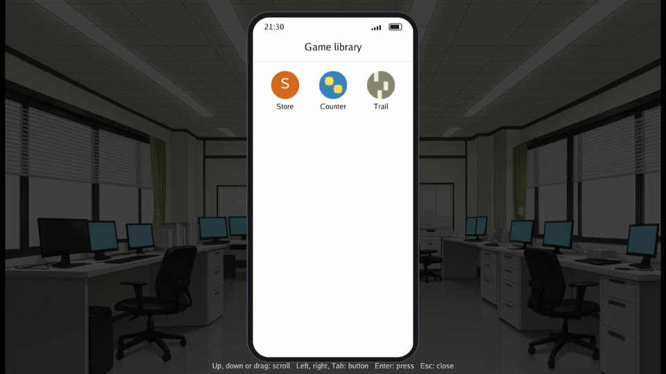

# Games inside phone apps

Gozen 0.23.0 can run standalone games inside the phone ([issue #159](https://github.com/nao1215/gozen/issues/159)). Desktop and browser tests cover opening games, returning to the host, independent saves and offline installed play. The public catalog includes Counter; the office examples use a local reviewed snapshot. See [ADR 0063](../decisions/0063-phone-game-packages.md) for runtime ownership and package trust.

A child is a standalone Gozen game packaged as a ZIP. A host declares the games it offers, opens them from ordinary phone events and keeps running when the child closes. The child has its own assets, state and saves. It cannot open another child. Child scores do not change the host's story variables.

The office sample's home screen lists the declared games with their own icons:



## Prepare the package and catalog

A package contains `game.yaml`, game data, assets and license notices. Put `game.yaml` at the ZIP root. Include a custom square static PNG icon, between 32 and 1024 pixels per side, no larger than 64 KiB. The reviewed catalog contains the same PNG as base64 `icon_data` so the store can show it before installation. Archive validation checks that both copies match.

The catalog records a package ID such as `studio/puzzle`, an exact version, title, author, description, licenses, orientation, compatible Gozen versions, HTTPS package URL, SHA-256, compressed size and unpacked size. Compatibility and allowed updates use an exact stable version such as `1.0.0` or a bounded range such as `>=1.0.0 <2.0.0`. Prerelease versions, a leading `v` and other range syntax are not accepted.

The host pins its initial local catalog snapshot with SHA-256. To offer catalog refresh, configure `catalog_url`, `catalog_signature_url` and a base64 Ed25519 `catalog_public_key` together. Both URLs must use HTTPS. The host verifies downloaded catalog bytes against that pinned key; a downloaded catalog cannot supply its own trust anchor. Refreshed catalogs may add releases but must preserve existing release records unchanged. Loading YAML never downloads a catalog or a game. Installation requires an explicit player action. New catalog entries do not add games to a host that did not declare them.

## Declare the host's apps

This example selects one included game and one optional download. Replace the catalog digest with the SHA-256 of your actual catalog bytes. The paths are relative to the host game directory. Optional apps have no bundled path.

<!-- verify: load group=phone-games as=game.yaml -->
```yaml
phone:
  catalog: apps/catalog.yaml
  catalog_sha256: aaaaaaaaaaaaaaaaaaaaaaaaaaaaaaaaaaaaaaaaaaaaaaaaaaaaaaaaaaaaaaaa
  apps:
    - id: puzzle
      package: studio/puzzle
      version: '>=1.0.0 <2.0.0'
      install: bundled
      bundled_version: 1.0.0
      path: apps/puzzle-1.0.0.zip
    - id: trail
      package: studio/trail
      version: 1.0.0
      install: optional
      when: flag.trail_available
```

`version` controls which releases the host allows. `bundled_version` identifies the exact ZIP shipped with the host and must fall inside that range. For an exact `version`, omit `bundled_version` to use that version. Bundling and updates are separate choices: including version 1.0.0 need not prevent the player from installing a later allowed release.

## Open a game or the store

Existing home buttons call ordinary events. `app: game` selects a local app ID; `app: store` displays the declared apps. The catalog release selects the child's portrait or landscape orientation; `hold` controls the phone's resting orientation when the child closes. The phone scales the child's authored canvas to fit that frame, preserving its layout. Closing the child returns to the phone event that opened it. The host's Back control stays outside the child's viewport; Shift+Escape closes the child, while Escape remains available to its own menus.

<!-- verify: load group=phone-games -->
```yaml
events:
  games_home:
    do:
      - phone:
          app: home
          title: Games
          rows:
            - {button: Puzzle, event: open_puzzle}
            - {button: Store, event: open_store}
  open_puzzle:
    do:
      - phone: {app: game, game: puzzle, hold: portrait}
  open_store:
    do:
      - phone: {app: store, title: Game library}
```

Saves are isolated by host identity, registered package ID and exact release version. An update does not overwrite an active game or reuse another release's saves. A failed package check must leave the current installation usable. Do not use child launch or return as a reward trigger without a separate authored story rule.

## Browser and replay limits

Browser downloads use the catalog release's `browser_url`: a direct HTTPS URL on `raw.githubusercontent.com`, pinned to a 40-character commit ID, with a portable ZIP path. Its bytes must match the same archive digest as the desktop URL. Fresh browser installation requires this mirror. Redirects are rejected, and the response must allow the host page's origin through CORS. Browser packages are limited to 64 MiB compressed, 256 MiB unpacked and 4096 ZIP entries; web export rejects bundled packages above these limits. Since v0.23.1, archive bytes use IndexedDB; selections and save files keep their localStorage format. Older base64 caches remain readable. Browser storage quotas may be lower than the package limits; failed writes preserve the previous installation. Desktop disk-backed packages can be up to 1 GiB compressed, 2 GiB unpacked and 32768 ZIP entries. A successful test with an intercepted fetch proves the browser installation path, not that a particular public download service supports CORS.

The host's gameplay and stream clock pause while a child runs; background visual animations may continue. Recorded music and voices resume from their paused positions. Browser synthesized speech stops on entry and restarts the host's current caption on return. Closing the child stops its synthesized speech.

Embedded streams have the same exact-replay restriction as standalone streams. Normal play and screenshots work, but an exact replay cannot reconstruct a live stream. Plain child games retain exact replay support. Optional installed archives fit into an exact trace only when their base64 cache payload fits the existing 8 MiB initial-save limit, roughly a 6 MiB ZIP; larger installed games remain playable, but exact replay reports that limit. Bundled archives remain external assets checked by their hashes.

## Verify a distribution

Run `gozen check` on the host and each standalone child. Export the host with a matching runtime and test the exported copy after moving the source directory away. Check both orientations, entering and leaving each game, saving and reopening it, and returning to an unchanged host. An export includes only declared bundled archives and the pinned catalog; unrelated ZIPs do not belong in the distribution.

The [neutral E2E fixture generator](../../e2e/atago/fixtures/phone-package/prepare.py) creates two games, their custom icons, deterministic ZIPs and a pinned catalog. The [desktop scenarios](../../e2e/atago/desktop.atago.yaml) exercise export and rejected packages. These are test fixtures, not a public game catalog.

To propose a game for the registry, use the [registration form](https://github.com/nao1215/gozen/issues/new?template=game-registration.yml). Include its source, release package, tested compatibility, custom icon and permission to distribute the code and assets. Submission starts a review; it does not publish the game automatically.

The office sample includes the same two original packages and gates their home icons with `flag.games_unlocked`. Open its `phone_games` event to try them. To rebuild the checked-in ZIPs and catalog from their source, run `python3 e2e/atago/fixtures/phone-package/prepare.py e2e/atago/fixtures/game examples/office/game packages-only` from the repository root. The command prints the phone configuration with the new catalog digest; update the digest in the office's `game.yaml` if package bytes changed. The office does not configure network catalog refresh.
