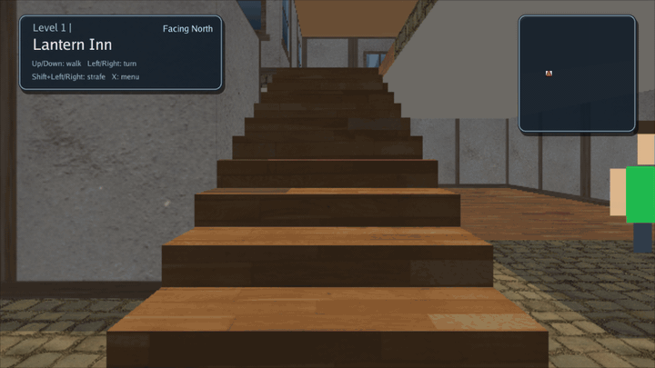

# Building a continuous town

`examples/space-buildings/game` is a compact public town: a timber inn with two usable floors and a closed gable roof, a red shop with a real doorway and striped canopy, and a stone building with a walkable flat slab roof. The outside stair provides a view of the other buildings. All remain in one location.

```sh
gozen check examples/space-buildings/game
gozen run examples/space-buildings/game --start inn
```

Up/Down walk, Left/Right turn, Shift+Left/Right strafe, and Z interacts. The sample enables continuous movement and draws the view up to 1280 pixels across with `render_width: 1280`; omitted, a space is drawn at most 640 pixels across and scaled to the window, which bounds browser and CI cost. `scripts/capture-space-buildings.txt` walks through the shop, climbs the stone building, visits the inn's upper floor, returns to the street and reloads at an arbitrary yaw.

## Facades

<!-- verify: parse space fragment; merge with the sample levels, materials and locations -->
```yaml
space:
  materials:
    timber: {picture: timber.jpg, width: 4, height: 3}
    trim: {color: '#96683e'}
  wall_regions:
    - {level: 1, x: 1, y: 1, width: 7, depth: 6, material: timber, north: trim}
```

A region covers integer cells on one one-based level. Regions on the same level cannot overlap. `material` selects all wall faces; `north`, `east`, `south` and `west` override individual outward faces. Omitted faces retain the global dungeon wall. Assignment changes appearance only, including when a conditional wall appears or disappears.

Each material may combine `picture` tint/brightness and an opaque `color`. `width` and `height` are world units per complete image repetition in `[0.125, 128]`, defaulting to 1; they are not per-cell image sizes. A six-cell-wide facade can use `width: 6` to span the building. Walls use world X on north/south faces, world Z on east/west faces, and negative world height vertically. `origin_u` and `origin_v` offset these coordinates before division, so neighboring cells align. Roofs use world X/Z. Opposite faces use the same world-axis alignment.

Names start with a lowercase letter and contain lowercase letters, digits and underscores. At most 32 named materials and 128 regions are supported. Image tiles are resampled to 512×512 in a shared atlas and filtered bilinearly; this bounds texture memory and batches compatible surfaces. Alpha is composited against white, not treated as a hole. Global materials use their original path when building features are absent.

A material can also animate. `frames` lists pictures under `assets/` (a pattern such as `shop/*.jpg` stands for the files it matches, sorted) that replace the picture's file in turn, `fps` times a second (default 12), keeping its tint and brightness. The sample's shop sign blinks with two frames at `fps: 2`; torches, water, signs and screens work the same way, on walls, floors, stairs and roofs. Only a frame change redraws that material's atlas tile. One space keeps at most 256 frames loaded, and every frame of a material shares its width, height and origins.

The sample's windows are painted, opaque decoration. Doorways are genuinely walkable floor cells with no wall. Partial-height windows, railings and door-frame geometry are not supported: use grid openings and decorative art, or redesign the facade. The renderer does not claim painted windows are see-through.

## Floors and stairs

<!-- verify: parse space fragment; merge with the sample levels, materials and locations -->
```yaml
space:
  materials:
    boards: {picture: boards.jpg, width: 2, height: 2}
    mosaic: {picture: mosaic.jpg, width: 2, height: 2}
  floor_regions:
    - {level: 1, x: 2, y: 2, width: 5, depth: 4, material: boards}
    - {level: 1, x: 13, y: 3, width: 4, depth: 4, material: mosaic}
  stairs:
    - {level: 1, x: 3, y: 7, facing: north, length: 3, material: boards}
```



A floor region gives the walking surfaces of a rectangle on one one-based level their own material: the floor tops, the exposed edges of their slabs and the stairs that rise from that level. The sample's street keeps the dungeon's `floor_texture` (cobblestones), the inn has boards on both floors and the shop a marble mosaic. A stair's own `material` takes precedence over the region, so the inn's entrance stair is wooden and the outside stair stone. Ceilings and collision are unchanged.

Tops use world X/Z like roofs, so `width: 4, height: 4` lays one picture over four by four cells and `origin_u`/`origin_v` place it; risers and edges use world X or Z and negative height like walls. Regions on the same level cannot overlap, at most 128 are allowed, and they share the 32 named materials with walls and roofs.

## Relief and light

<!-- verify: parse space fragment; merge with the sample levels, materials and locations -->
```yaml
space:
  render_width: 1280
  daylight: 0.45
  materials:
    stone: {picture: stone.jpg, normal: normal/stone.jpg, width: 2, height: 1.5}
  lights:
    - {level: 1, x: 12, y: 7, height: 1.3, radius: 5, power: 1.6, flicker: 0.25}
```

`normal` adds a tangent-space normal map in the OpenGL convention (green up, as Poly Haven's `nor_gl` maps) to a material. The sun and the lights then pick out mortar, cobbles and planks without changing the geometry; the map is kept at 256 pixels and shares the material's size and origins. `daylight` scales the sun and the sky from 1 (omitted, full day) to 0 (night, a faint blue floor), and darkens the sky with it.

`lights` are up to 16 point lights at a cell's center, `height` above that level's floor (default 1.2). `radius` is their reach in cells (default 4, at most 16), `color` defaults to warm white, `power` (default 1, at most 8) scales them and `flicker` from 0 to 1 makes them waver like a flame. Full-height walls between a light and a surface block it; upright pictures are lit by the lights around them as a whole. The sample is set at dusk with lanterns at the inn's door, the shop's sign, the street and inside both buildings.

`render_width` is the most pixels across the view is drawn at before it is scaled to the window. Omitted, it is 640, which keeps browser and CI cost bounded; up to 3840 draws sharper facades on a desktop. The cost grows with the pixel count and with the lights that reach the view.

## Roofs and canopies

<!-- verify: parse space fragment; merge with the sample levels, materials and locations -->
```yaml
space:
  roofs:
    - shape: gable
      filled: true
      level: 3
      base: 0.12
      x: 0.75
      y: 0.75
      width: 7.5
      depth: 6
      rise: 1
      thickness: 0.15
      facing: east
      material: tile
      underside: trim
```

`level` anchors the base to `(level - 1) × 1.5` world units; `base` adds 0 to 1.5. The level may be an existing story or the top of the final story. X/Y and width/depth are continuous horizontal bounds, including eaves, entirely inside the map; each dimension is at least 0.125 cells. Rise is positive and at most 2; flat roofs require zero rise. Thickness is vertical and in `[0.01, 0.5]`.

- `gable` rises from the named facing's low edge toward the center and descends to the opposite edge. East/west produces a north–south ridge; north/south produces an east–west ridge.
- `shed` rises in `facing`, from one edge to the opposite edge.
- `flat` is a horizontal canopy; still supply a cardinal `facing` for a consistent schema.

With `filled: false` (default), the underside follows the slope at a constant vertical thickness. This can leave an open attic at a gable end. `filled: true` seals the volume down to a flat underside at base minus thickness, closing the triangular ends. Use it for closed buildings; use an unfilled slab for a visible sloping canopy underside. Roof sides and undersides are actual opaque geometry, including from above and at arbitrary yaw.

`material` selects top/side appearance and `underside` selects bottom appearance. Without a named material, roofs use warm tile and wood colors. Roofs are not walkable. Use an ordinary upper-floor slab for a terrace or the stone building's accessible flat roof.

Roof/wall intersections are permitted at eaves. Roofs may touch each other or a floor slab, but positive-volume roof/roof overlap is rejected. Avoid coincident decorative surfaces; a terrain surface wins an exact depth tie. Walking/stair headroom must stay clear. Runtime circle/body collision also prevents entering a narrow roof overhang from adjacent elevated floors. At most 32 roofs, 64 compiled parts and four parts per horizontal cell are allowed. Unsupported shapes, nonfinite dimensions and missing materials fail `gozen check`.

## Assets and verification

The building materials are built by `scripts/generate-space-buildings.py` from CC0-1.0 photographic textures by [Poly Haven](https://polyhaven.com) (1k diffuse maps, checked against the MD5 that Poly Haven publishes), with Pillow drawing the windows, half-timbering, shop sign and canopy over them. The results are CC0-1.0 as well:

| File | Poly Haven source | Use |
| --- | --- | --- |
| `cobble.jpg` | [cobblestone_floor_08](https://polyhaven.com/a/cobblestone_floor_08) | Street (`floor_texture`) |
| `boards.jpg` | [old_wooden_floor_01](https://polyhaven.com/a/old_wooden_floor_01) | Inn floors and stair |
| `mosaic.jpg` | [marble_mosaic_tiles](https://polyhaven.com/a/marble_mosaic_tiles) | Shop floor |
| `timber.jpg` | [white_plaster_02](https://polyhaven.com/a/white_plaster_02), [weathered_brown_planks](https://polyhaven.com/a/weathered_brown_planks) | Inn facade |
| `shop/0.jpg`, `shop/1.jpg` | [red_brick](https://polyhaven.com/a/red_brick), [weathered_brown_planks](https://polyhaven.com/a/weathered_brown_planks) | Shop facade, sign out and lit |
| `stone.jpg` | [stone_wall_04](https://polyhaven.com/a/stone_wall_04) | Stone building and outside stair |
| `roof.jpg` | [clay_roof_tiles_02](https://polyhaven.com/a/clay_roof_tiles_02) | Roofs |
| `canopy.jpg` | None (drawn) | Shop canopy |

The copied innkeeper and bed are the existing original CC0-1.0 fixtures from `examples/space-town/game/assets/`. No models are bundled.

See [performance measurements](../development/space-performance.md) and [the building geometry decision](../decisions/0045-building-surfaces-and-roofs.md). Existing YAML and saved positions retain their meaning. Reload replaces the geometry/material cache; state changes rebuild conditional occupancy without rebuilding immutable roof data.
