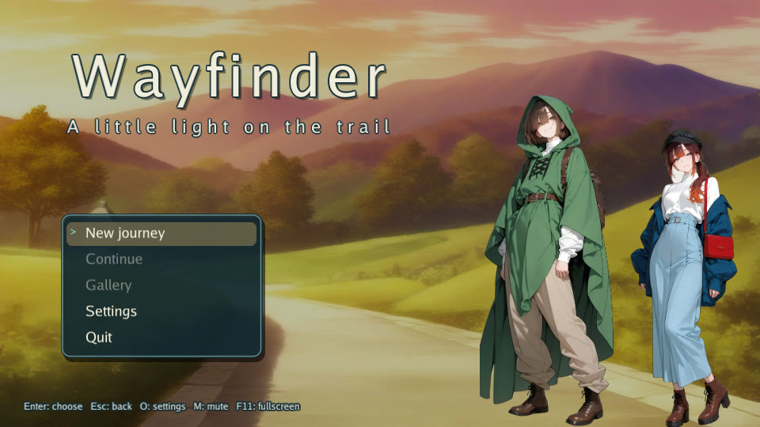
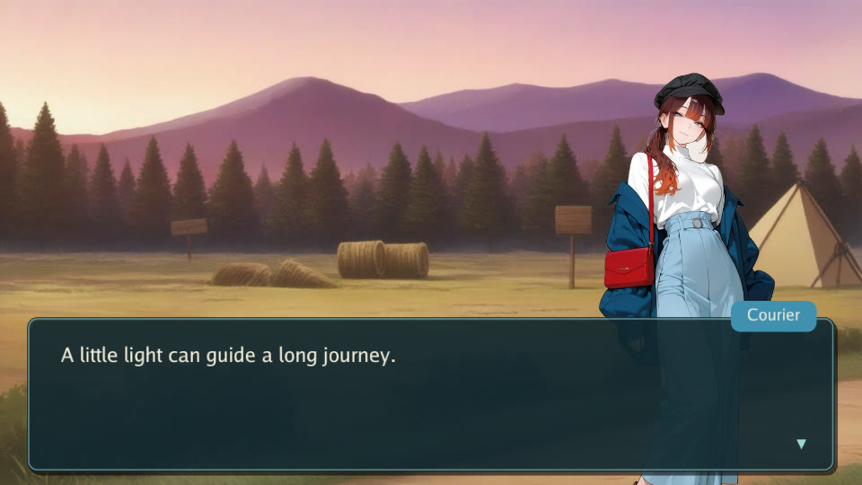
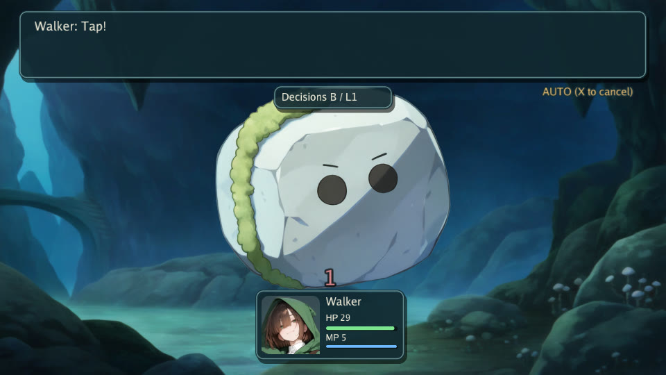
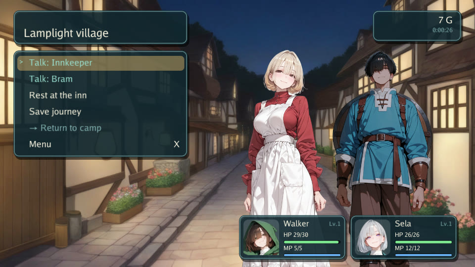

# Wayfinder

Wayfinder is an original, small game assembled with the public Gozen API. Practice with a friendly stone companion, light a trail marker, and walk to Lantern ridge. A village with an inn, a grotto with a wild Pebble to fight again (plus a sturdier Cobble and a rockfall of three for balance checks), and a side room with first-person grid movement round it out. The story, names, dialogue and pictures were made for this repository; the pictures are CC BY 4.0, see [ASSETS.md](../../ASSETS.md).






## Run

From the repository root, with Go 1.26.4 or later and a [graphics environment](../development/graphics.md#requirements):

```sh
go run ./examples/play --mute
```

The example embeds its YAML and pictures (`examples/play/game/`, laid out like a game directory) in the binary. It needs no downloaded assets, ONNX models, audio device or external game directory. `--mute` disables audio initialization. There is no sample music or sound recording.

## Play through

1. Select **New journey**, then **Talk: Courier**. Enter advances the two lines.
2. Select **Practice**. In battle, select **Auto** to let the engine fight, or choose **Attack**, then Pebble as the target, each turn. Winning unlocks **Light the marker**.
3. Select **Light the marker**, read the message, then **Walk to the ridge**. The arrival event awards 4G once; practice awarded 3G.
4. Select **Save journey**, choose slot 1 and wait for confirmation. Press Esc to open the menu, choose **Return to title**, confirm, and use **Continue** to restore the journey. Menu **Load** also restores a slot after confirmation.
5. Return to camp and select **Visit the village** to talk to the innkeeper or rest at the inn, or **Enter the grotto** to fight a wild Pebble again. The grotto also offers **Face the Cobble** and **Brave the rockfall**, which are much harder at level 1.
6. Return to camp and select **Explore chamber**. Up walks forward, Left/Right turns, Down turns around. Reach **L** to read the window event; **C** leads back to camp. The minimap fills as you walk.

The ridge path is hidden until its marker is lit. Revisiting the ridge after loading does not award its arrival reward again. These transitions and the room's return route are checked against the same definitions in `examples/play/journey_test.go:16`.

## Controls and saves

| Input | Meaning |
| --- | --- |
| Up / Down, Enter / Z / Space | Menu selection and confirmation |
| X / Esc | Back, or open the field menu |
| O / F2 | Settings |
| F11 / Alt+Enter | Fullscreen |
| M | Mute |
| F7 (with `--dev`) | Balance panel: win rate, HP left and win rate by level for the battles here ([details](../development/graphics.md#バランス表示)) |
| Up, Left / Right, Down in the room | Forward, turn, turn around |

Normal saves use the platform config directory under `gozen/wayfinder-demo`: typically `$XDG_CONFIG_HOME` or `~/.config` on Linux, `%AppData%` on Windows, and `~/Library/Application Support` on macOS. An explicit `--save-dir` is the complete destination. The scripted capture uses a private temporary directory and removes it when finished. A development run with `--start` also isolates saves unless a destination is explicit (`runner/runner.go:128`, `internal/play/play.go:356`).

The bundled Go Regular font supports the English sample text. Some optional settings and status labels still use the engine's Japanese defaults. Full localization and a larger font are left to the game author. Main journey dialogue, battle commands and save prompts have English overrides in `examples/play/game/game.yaml:18`.

## Capture

On Linux, install Go, Python 3, ffmpeg, Xvfb and xauth (ffmpeg must include ffprobe), plus the libraries in [graphics setup](../development/graphics.md#requirements). Python uses only its standard library here. Run from the repository root:

```sh
xvfb-run --auto-servernum --error-file=/dev/stderr bash scripts/capture-example.sh
```

The script builds the actual sample, fixes its seed, selects its menu actions, talks to the courier, runs the practice battle, lights the marker, walks to the ridge, saves, returns to the title, restores the slot, visits the village, and walks to the lantern in the observation room. The game writes about sixty PNG frames from its Draw loop, five per second of animation. Before encoding, Python checks that the actual save contains the ridge location, the completion flag and 7G, that the trace ends at the lantern in the room, and that every generated picture was shown. It encodes a 12.8-second, 800×450 GIF (about 1.5 MB) to `docs/images/wayfinder.gif` and writes four 960×540 JPEG screenshots (`wayfinder-title.jpg`, `-talk.jpg`, `-battle.jpg`, `-village.jpg`). The GIF is a sequence of real captured frames played at five per second, not a continuous screen recording. The generated executable stays in ignored `build/capture/`; temporary saves, traces and intermediate frames are removed. Existing showcase files are replaced.

`capture-example.txt` is the input sequence, `capture-example.sh` owns temporary paths and prerequisites, and `capture-example.py` validates progress and encodes the images. Failures return a nonzero status. The script checks the final room position in the trace and the encoded GIF dimensions and duration with ffprobe. The game run has a 240-second timeout. `scripts/capture-balance.sh` (with `scripts/capture-balance.txt`) captures the development balance panel in the grotto to `docs/images/wayfinder-balance.jpg` in the same 960×540 JPEG form.


For independent screen checks, run:

```sh
xvfb-run --auto-servernum --error-file=/dev/stderr make graphics
```

Windows/macOS are intended interactive targets; runtime verification is still pending. The capture wrapper is for Linux. Capture success does not verify audio, every menu, or those other operating systems. See the [release checklist](../development/release-checklist.md).

## Small examples

`examples/minimal` is a 35-line Go host with 17 lines of YAML across `game.yaml` and `data/world.yaml`. It loads an embedded `fs.FS`, creates state and runs the first arrival event without graphics. The two default battle skill IDs must exist even in a game without battles. Its only output is `location=camp gold=2`.

`examples/headless` demonstrates deterministic movement, a choice, battle and a save/restore round trip in memory. Its output is `location=trail battles=1 wins=1 gold=3`. Neither example writes player saves.

```sh
go run ./examples/minimal
go run ./examples/headless
```
